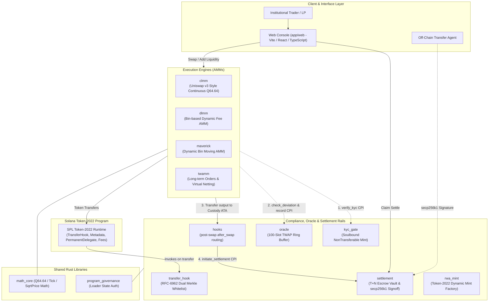
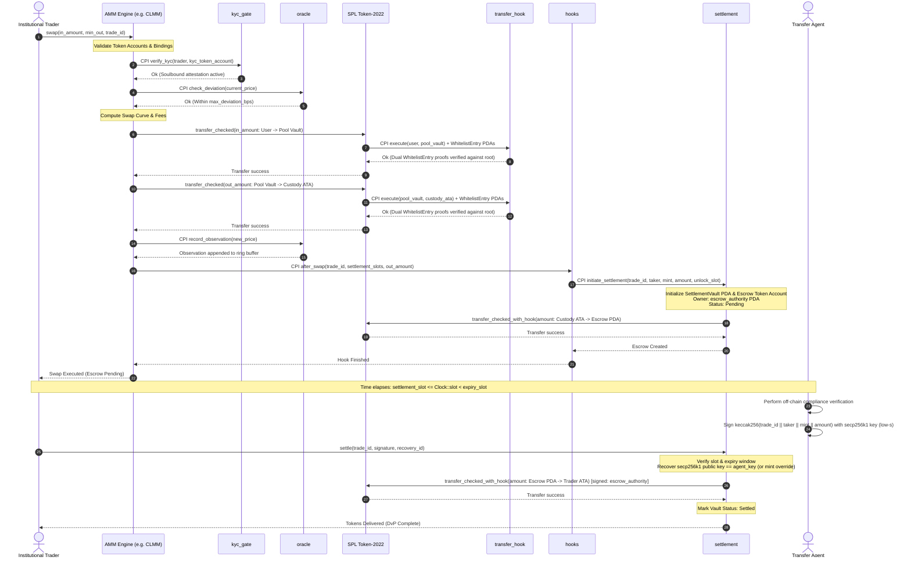

# System Architecture — Solana RWA DEX

An institutional-grade decentralized exchange and settlement infrastructure built on Solana, purpose-engineered for Real World Assets (RWAs). The platform combines four specialized Automated Market Maker (AMM) execution engines with native Token-2022 compliance extensions, soulbound KYC gating, a time-weighted oracle circuit breaker, and an off-chain Transfer Agent-cleared T+N settlement escrow.

---

## Table of Contents

- [1. Architectural Vision \& Design Philosophy](#1-architectural-vision--design-philosophy)
- [2. System Architecture Diagram](#2-system-architecture-diagram)
- [3. Program Catalog \& Shared Libraries](#3-program-catalog--shared-libraries)
  - [Shared Libraries](#shared-libraries)
- [4. Compliance, Oracle \& Settlement Rails](#4-compliance-oracle--settlement-rails)
  - [4.1. `rwa_mint` — Dynamic Token-2022 Mint Factory](#41-rwa_mint--dynamic-token-2022-mint-factory)
  - [4.2. `transfer_hook` — RFC-6962 Dual-Proof Merkle Whitelist](#42-transfer_hook--rfc-6962-dual-proof-merkle-whitelist)
  - [4.3. `kyc_gate` — Soulbound Institutional Identity Attestation](#43-kyc_gate--soulbound-institutional-identity-attestation)
  - [4.4. `oracle` — Ring-Buffer TWAP \& Circuit Breaker](#44-oracle--ring-buffer-twap--circuit-breaker)
  - [4.5. `settlement` — T+N Escrow Clearinghouse with secp256k1 Verification](#45-settlement--tn-escrow-clearinghouse-with-secp256k1-verification)
  - [4.6. `hooks` — Post-Swap AMM Interception \& Escrow Routing](#46-hooks--post-swap-amm-interception--escrow-routing)
- [5. The Four AMM Execution Engines](#5-the-four-amm-execution-engines)
  - [5.1. `clmm` — Concentrated Liquidity Market Maker](#51-clmm--concentrated-liquidity-market-maker)
  - [5.2. `dlmm` — Dynamic Liquidity Bin Market Maker](#52-dlmm--dynamic-liquidity-bin-market-maker)
  - [5.3. `maverick` — Directional Dynamic Distribution AMM](#53-maverick--directional-dynamic-distribution-amm)
  - [5.4. `twamm` — Time-Weighted Average Market Maker](#54-twamm--time-weighted-average-market-maker)
- [6. Shared Core Libraries](#6-shared-core-libraries)
  - [6.1. `libs/math_core`](#61-libsmath_core)
  - [6.2. `libs/program_governance`](#62-libsprogram_governance)
- [7. End-to-End Trade Lifecycle \& Execution Flow](#7-end-to-end-trade-lifecycle--execution-flow)
- [8. Frontend Console Architecture (`app/web`)](#8-frontend-console-architecture-appweb)
- [9. Off-Chain Services \& Infrastructure](#9-off-chain-services--infrastructure)
- [10. Trust Boundaries \& Security Invariants](#10-trust-boundaries--security-invariants)
  - [10.1. Privileged Authority Roles](#101-privileged-authority-roles)
  - [10.2. Critical Security Invariants](#102-critical-security-invariants)

---

## 1. Architectural Vision & Design Philosophy

Institutional tokenization of Real World Assets (Treasuries, private credit, commercial real estate, structured debt, and carbon credits) requires structural safeguards that conventional, permissionless retail DEXs cannot provide:

1. **Compliance at the Token Standard Level**: Regulatory transfer restrictions must be enforced regardless of the transfer interface (wallet-to-wallet, DEX swap, or OTC transfer). Custom wrapped tokens introduce counterparty risk; instead, this DEX builds natively on **SPL Token-2022 (Token Extensions)**.
2. **Pre-Trade Eligibility Verification**: Trading venues must enforce KYC/AML accreditation before swaps occur, preventing delisted or sanctioned counterparties from interacting with liquidity pools.
3. **Decoupled Execution and Clearing (T+N Settlement)**: Traditional institutional finance settles trades over a clearing window ($T+0$, $T+1$, or $T+2$) where an authorized Transfer Agent validates tax, regulatory, and transfer credentials before final delivery versus payment (DvP).
4. **Market Integrity & Circuit Breakers**: Flash crashes, stale oracles, and sandwich attacks pose severe systemic risks to yield-bearing and debt instruments. Integrated TWAP circuit breakers provide automatic, cryptographic halting mechanisms.
5. **Diverse Market Structures**: No single AMM model fits all RWA asset classes. Pegged yield-bearing tokens need concentrated tick liquidity (`clmm`); volatility-sensitive assets require discrete zero-slippage bins with dynamic fees (`dlmm`); trending or rebalancing assets demand dynamic bin migration (`maverick`); and institutional block orders require fragmentation and virtual netting (`twamm`).

---

## 2. System Architecture Diagram



---

## 3. Program Catalog & Shared Libraries

The system comprises ten Anchor programs and two shared Rust crates. Program IDs are cluster-independent, hardcoded via `declare_id!`, and backed by deployment keypairs under `target/deploy/`:

| Program | Program ID | Source Directory | Primary Architectural Role |
| :--- | :--- | :--- | :--- |
| [`oracle`](../programs/oracle) | `4ENC2RRJGUhttqMvqztBBFtP7dn3cvMQZvgfBG1pmFoj` | `programs/oracle` | 100-observation TWAP ring buffer, price deviation guard, and emergency pool circuit breaker. |
| [`kyc_gate`](../programs/kyc_gate) | `7Tqk6HWJcnEPAdNdRy4ZfqreaNuT9nqFSCLdnLCYnDK1` | `programs/kyc_gate` | Soulbound (`NonTransferable`) Token-2022 KYC credentials, admin issuance/revocation, and CPI `verify_kyc` gate. |
| [`transfer_hook`](../programs/transfer_hook) | `fo9ANuG3MfLiiQcqipXLNaSoPoMyp4ArAzJtwNbhxNS` | `programs/transfer_hook` | RFC-6962 Merkle-proof whitelist hook verifying both sender and receiver membership on every Token-2022 transfer. |
| [`rwa_mint`](../programs/rwa_mint) | `5GbeJh4sySASsdH2zRdFX85LuXnu5y3rBkqhVi76Lzho` | `programs/rwa_mint` | Permissionless factory for dynamic Token-2022 RWA mints with Transfer Hook, Metadata Pointer, Delegate, and Fee configs. |
| [`settlement`](../programs/settlement) | `58sKC5UqKZrMrSj5bGoEdyfwbckm2CwvrHPDCbESoLJ6` | `programs/settlement` | Institutional clearinghouse: per-trade $T+N$ escrow vault, time lock, and off-chain Transfer Agent secp256k1 signature validation. |
| [`hooks`](../programs/hooks) | `B5thQMyLNmPsgWVnsscaP4BFUMVW7QFwnufiJKq6Y1DA` | `programs/hooks` | Post-swap AMM hook intercepting swap proceeds and routing them into the settlement escrow via the `hook_authority` PDA. |
| [`clmm`](../programs/clmm) | `GKvqhzy7V6MN8YRuQchWahMJLG4cbHWdWzEWyoSG1XNU` | `programs/clmm` | Uniswap v3-style concentrated liquidity AMM, continuous Q64.64 sqrt-price curve, tick bitmap walking, and admin pause. |
| [`dlmm`](../programs/dlmm) | `5JPnmJouZ3yE9Xwaacjtr5F2E1ShYGxJ1mR4UV9EFE3c` | `programs/dlmm` | Discrete bin dynamic liquidity AMM, zero slippage within bins, volatility-adjusted dynamic fees, and Euclidean indexing. |
| [`maverick`](../programs/maverick) | `9hQXDPwodmaTZYaAEDVE8EWRKb3d39Wr2Lb3zFgSaBW4` | `programs/maverick` | Dynamic distribution AMM with directional bin moves (`Right`, `Left`, `Both`), static baseline, and in-place fixed-stride updates. |
| [`twamm`](../programs/twamm) | `FeApqgNan2ifjbhzK1dvDJxdEM45xEEgFJPpCzKr72H9` | `programs/twamm` | Time-Weighted Average Market Maker for institutional block orders; virtual order pooling and netting prior to AMM routing. |

### Shared Libraries

- [`libs/math_core`](../libs/math_core): Core numerical primitives: Q64.64 fixed-point math, 256-bit safe arithmetic, tick-to-sqrt-price and sqrt-price-to-tick transformations, and swap step calculations.
- [`libs/program_governance`](../libs/program_governance): BPF Upgradeable Loader inspection utility (`require_upgrade_authority`) validating that one-time initializers are executed exclusively by the program's upgrade authority.

---

## 4. Compliance, Oracle & Settlement Rails

### 4.1. `rwa_mint` — Dynamic Token-2022 Mint Factory

Traditional SPL Token mints have a static account size (82 bytes). However, Token-2022 mints with multiple extensions require dynamic account sizing and strict initialization ordering:

1. **Dynamic Byte Sizing**:
   $$L = 166 + \sum_{e \in E} (4 + |e|) + L_{\text{metadata}}$$
   The program computes total space using `ExtensionType::try_calculate_account_len::<SplMint>(&extensions)` ($450$ bytes for `TransferFeeConfig`, `MetadataPointer`, `TransferHook`, and `PermanentDelegate`) plus `TokenMetadata::tlv_size_of(&metadata)` ($92 + |name| + |symbol| + |uri|$ bytes).
2. **Atomic Initialization Sequence**:
   - System Program `create_account` funded with rent-exempt lamports for $L$ bytes.
   - Extension initializers invoked *before* the base mint: `TransferHook`, `MetadataPointer`, `PermanentDelegate`, `TransferFeeConfig`.
   - `initialize_mint2` invoked to establish decimals (typically 6) and mint/freeze authorities.
   - Embedded `TokenMetadata` written via the SPL metadata pointer interface (linking off-chain ISIN, CUSIP, and NAV documentation).
3. **Permanent Delegate**: Configured as an administrative/regulatory multisig key, enabling asset recovery or court-ordered seizure as required under financial market regulations.

### 4.2. `transfer_hook` — RFC-6962 Dual-Proof Merkle Whitelist

Every transfer of an RWA token triggers the Token-2022 Transfer Hook extension, which CPIs into `transfer_hook::execute`:

- **Dual-Proof Verification**: Both the **source** owner and the **destination** owner must supply valid Merkle paths proving inclusion in the on-chain root (`config.merkle_root`). Checking both sides prevents delisted institutions from dumping assets to unsuspecting parties.
- **RFC-6962 Domain Separation**: Leaves are hashed with a `0x00` prefix (`H(0x00 || pubkey)`), and internal nodes are hashed with a `0x01` prefix (`H(0x01 || left || right)`). Nodes are position-sorted (`min(a, b) || max(a, b)`), preventing second-preimage attacks.
- **Auditable Commitment**: The whitelist is one **32-byte root** in the hook config, so a rotation is a single write and membership is proved from public inputs rather than asserted by a lookup. Each institution's path is stored in its own `WhitelistEntry` PDA (about 0.0048 SOL of rent-exempt deposit, refunded on delisting), because Token-2022 gives the hook no way to receive a proof as instruction data.
- **ExtraAccountMetaList**: Manages the extra accounts required by the transfer hook via the standard Token-2022 hook interface.

### 4.3. `kyc_gate` — Soulbound Institutional Identity Attestation

Trading on the DEX requires verified institutional KYC. Rather than reading a mutable off-chain whitelist table, `kyc_gate` utilizes on-chain soulbound attestations:

- **Soulbound Credential**: The KYC mint (`[b"kyc-mint"]`) has the `NonTransferable` Token-2022 extension enabled. The SPL runtime strictly prevents transferring, loaning, or selling this token.
- **One Token Per Institution**: `issue_kyc` mints exactly 1 unit to the institution's associated token account.
- **Immediate Non-Consensual Revocation**: The mint's `PermanentDelegate` is the `KycConfig` PDA (`[b"kyc-config"]`). If an institution fails continuous AML monitoring, `revoke_kyc` burns the attestation directly, without requiring the holder's signature.
- **Pre-Swap Verification**: AMM swap instructions CPI into `verify_kyc`, verifying that the transaction signer holds the active soulbound KYC token.

### 4.4. `oracle` — Ring-Buffer TWAP & Circuit Breaker

The oracle program enforces price sanity and prevents flash-loan price manipulation:

- **100-Observation Ring Buffer**: `OBSERVATION_COUNT = 100` slots record `(timestamp, sqrt_price_x64, cumulative_price_x64)`.
- **Interpolation and Extrapolation**: For any requested window $\Delta t$, the accumulator is interpolated between stored boundary observations and extrapolated to current timestamp $t_{\text{now}}$.
- **Circuit Breaker Check**: During every swap, the AMM queries `oracle::check_deviation`. If:
  $$\left| \frac{S_{\text{current}} - S_{\text{TWAP}}}{S_{\text{TWAP}}} \right| > \text{max\_deviation\_bps}$$
  the swap instruction immediately reverts.
- **Emergency Latch (`trip_breaker`)**: If deviation thresholds are breached repeatedly, the pool's signed state invokes `trip_breaker`, latching `is_paused = true`. Only the designated oracle owner can invoke `unpause_pool`.
- **Pool PDA Authentication**: Oracle updates require the calling AMM pool PDA's signature, guaranteeing that external actors cannot spoof prices.

### 4.5. `settlement` — T+N Escrow Clearinghouse with secp256k1 Verification

To mirror traditional capital market clearing cycles ($T+1$, $T+2$), trade outputs are escrowed rather than immediately delivered:

- **Per-Trade Settlement Vault PDA**: Derived as `[b"settlement", trade_id.to_le_bytes()]`. Records `(trade_id, taker, token_mint, amount, settlement_slot, expiry_slot, status, pool, refund_source)`.
- **Fixed Escrow Authority**: Escrow token accounts are derived per trade as `[b"escrow", trade_id.to_le_bytes()]`, but owned by the fixed `[b"escrow_authority"]` PDA. This allows a single whitelist entry for `escrow_authority` to cover every trade under the transfer hook.
- **Two Independent Release Gates**:
  1. **Temporal Gate**: Must satisfy `settlement_slot <= Clock::slot < expiry_slot`. The window closes one program constant after T+N (`EXPIRY_WINDOW_SLOTS = 216 000`); past it the escrow is refund-only.
  2. **Transfer Agent Cryptographic Gate**: Requires a valid 64-byte compact secp256k1 signature from the off-chain Transfer Agent, in low-s form (the high twin is rejected).
- **Strict Preimage Binding**: The Transfer Agent signs `keccak256(trade_id || taker || mint || amount)`. The on-chain handler uses `solana-secp256k1-recover` to extract the public key $Q$ and asserts:
  $$Q == \text{agent key for this mint}$$
  A `[b"agent", mint]` override set by the config authority wins when the caller passes that account; otherwise the config's global key is used.
- **Permissionless Settlement**: Once valid, *anyone* (taker, keeper, or AMM) can invoke `settle` to release funds to the taker.
- **Refund Safeguards**: `cancel_settlement` is the compliance exit (config authority or initiating pool), and the permissionless `refund_expired` is the hard deadline. Both pay only the recorded `refund_source`, so neither can divert a unit.
- **Rent Reclamation**: `close_settlement` closes a terminal trade's empty escrow and vault PDA, returning both rents to the config authority.

### 4.6. `hooks` — Post-Swap AMM Interception & Escrow Routing

Acts as the "Uniswap v4 hook" layer of the protocol:

- The AMM completes the token swap and pays output tokens into the `hook_authority`'s custody Associated Token Account (ATA).
- The AMM invokes `hooks::after_swap(trade_id, settlement_slots, amount)`.
- `hooks` derives the settlement slot as $\text{Clock::slot} + \text{settlement\_slots}$ and executes a CPI into `settlement::initiate_settlement`.
- The `hook_authority` PDA (`[b"hook_authority"]`) signs the transfer from custody ATA into the `[b"escrow", trade_id]` escrow token account owned by `[b"escrow_authority"]`.

---

## 5. The Four AMM Execution Engines

All four AMM engines expose the same **Pool Wiring Rails** (`kyc_config`, `oracle_state`, `hooks_authority`, `settlement_slots`) and all four take either token program:

| Engine | Token program | Transfer-fee handling | Transfer-hook accounts forwarded |
| :--- | :--- | :--- | :--- |
| `dlmm` | `TokenInterface` (legacy + 2022) | yes (`transfer_and_measure`) | yes — swap/liquidity hook accounts reach both the transfers and `hooks::after_swap` |
| `maverick` | `TokenInterface` (legacy + 2022) | yes (`transfer_and_measure`) | yes — same as `dlmm` |
| `twamm` | `TokenInterface` (legacy + 2022) | yes (`transfer_and_measure`) | yes — hook accounts follow the order list and are forwarded into transfers and `hooks::after_swap` |
| `clmm` | `TokenInterface` (legacy + 2022) | exact receipt, fee grossed up (`transfer_tokens_exact`) | yes — hook accounts arrive as remaining accounts after the tick walk and are forwarded into every transfer |

CLMM's accounting is exact on the input side — a position is minted with the
liquidity the deposit amounts were computed for, and a swap's output is priced on
the input the vault is credited with. A mint whose Token-2022 `TransferFee`
extension would skim an inbound transfer is therefore **grossed up**: the
transfer carries the mint's fee on top (`calculate_pre_fee_amount`, for the epoch
in force), so the vault nets exactly what the math priced and the sender pays
the token's fee. `initialize_pool` sizes each vault from the extensions the mint
requires, so the vault carries the `TransferFeeAmount` extension such a mint
demands. Payouts are not grossed up — the vault is debited exactly `amount`
whichever extension the mint carries, and paying the fee on top would draw on the
other LPs. The consequence for a trader is that `min_amount_out` is enforced
against what leaves the vault, so an output mint with a fee delivers `amount_out`
minus that fee. Both inbound paths are covered end to end:
`a_fee_bearing_pool_deposits_and_swaps` (a 1% mint from the start) and
`a_fee_raised_after_funding_keeps_the_pool_trading` (a fee the issuer activates
on a mint the pool already holds). The balance delta is still measured: a token
program that charged a fee the gross-up missed is refused with
`TransferAmountMismatch` rather than credited short.

The web client resolves each mint's program (`tokenProgramForMint`) and derives
ATAs / passes the token-program account accordingly on every page. For a
hook-bearing mint the builders also take the hook accounts (`hookAccounts`, from
`hookTransferAccounts` via `hookAccountsForTransfers`) and append them as
remaining accounts; the programs filter them out by owner so the bin/order walk
is unaffected, then forward them into every transfer and into
`hooks::after_swap`. The hook checks **both** sides of a transfer, so a pool over
a hook-gated mint needs a whitelist entry for the pool PDA that owns the vaults
(and for the hooks authority's custody account when settlement routing is on)
before it can trade.

```
                    ┌──────────────────────────────────────────────┐
                    │               RWA DEX POOL RAILS             │
                    └──────────────────────┬───────────────────────┘
                                           │
         ┌───────────────────┬─────────────┴───────┬───────────────────┐
         ▼                   ▼                     ▼                   ▼
┌─────────────────┐ ┌─────────────────┐ ┌─────────────────┐ ┌─────────────────┐
│      CLMM       │ │      DLMM       │ │    Maverick     │ │      TWAMM      │
│  Concentrated   │ │  Discrete Bins  │ │ Dynamic Moving  │ │   Time-Sliced   │
│  Continuous Q64 │ │ Zero-Slippage   │ │ Directional LP  │ │ Virtual Netting │
└─────────────────┘ └─────────────────┘ └─────────────────┘ └─────────────────┘
```

### 5.1. `clmm` — Concentrated Liquidity Market Maker

Designed for pegged and correlated assets (e.g., tokenized US Treasuries vs. USDC):

- **Continuous Price Curve**: Stores $\sqrt{P} \cdot 2^{64}$. Prices map to ticks $t$ via $S(t) = 1.0001^{t/2} \cdot 2^{64}$.
- **Tick Bitmap Walk**: Ticks are mapped onto a compact bitfield (`BITMAP_BITS_MAX = 65,536`). Swaps traverse active ticks passed as remaining accounts. The handler verifies the ordering against the bitmap to prevent callers from bypassing tick transitions.
- **Uniswap-v3 Exact Fee Accounting**: Input fees are computed per tick step:
  $$\text{fee} = \left\lceil \frac{\text{in} \times f}{1,000,000 - f} \right\rceil$$
  Fees accrue via global accumulators $G_{\text{token}} \mathrel{+}= \frac{\text{fee} \cdot 2^{64}}{L_{\text{active}}}$ and per-tick outside accumulators.
- **Asymmetric Rounding**: Liquidity additions round deposit requirements *up*; removals and swap payouts round *down*.

### 5.2. `dlmm` — Dynamic Liquidity Bin Market Maker

Optimized for volatile or uncorrelated RWA pairs with discrete trading bands:

- **Discrete Price Bins**: Liquidity is grouped into discrete price bins spaced by `bin_step` basis points:
  $$P_{\text{whole}} = 1.0001^{(\text{bin\_id} \times \text{bin\_step})}$$
- **Zero Slippage Within Bins**: Swaps fill at the fixed bin rate until the bin's output reserve is exhausted before stepping to the next bin.
- **Bin Array Packing**: Bins are stored 70 per `BinArray` PDA account, utilizing Euclidean division ($index = \lfloor \text{bin\_id} / 70 \rfloor$, $\text{offset} = \text{bin\_id} \bmod 70$).
- **Volatility Fee Multiplier**: Base fee scales based on pool utilization:
  $$\text{Fee BPS} = \text{base\_fee\_bps} \times \left(1 + \frac{\text{utilization}}{100}\right)$$
  Utilization is set to $50\%$ for balanced bins and $90\%$ for one-sided bins.

### 5.3. `maverick` — Directional Dynamic Distribution AMM

Built for assets with steady directional trends (such as yield-accruing tokens or commodities):

- **Bin Kinds**:
  - `Static`: Fixed price, never moves.
  - `Right`: Automatically moves right as market price climbs above the bin.
  - `Left`: Automatically moves left as market price drops below the bin.
  - `Both`: Follows price bidirectionally.
- **Permissionless `move_bins`**: Anyone can invoke `move_bins` (incentivized keeper model). Out-of-range bins are relocated toward the active price without executing a token trade.
- **Value-Neutral Bin Merging**:
  $$\text{moved\_value} = \text{value}(\text{source reserves at destination price})$$
  $$\text{minted\_shares} = \text{moved\_value} \times \frac{\text{dest\_supply}}{\text{dest\_value}}$$
  $$\text{share\_ratio} = \frac{\text{minted\_shares} \cdot 2^{64}}{\text{source\_supply}}$$
- **Fixed-Stride Memory Architecture**: Bins are packed 50 per array with a constant 70-byte stride using a fixed `MoveState { moved: bool, to_bin_id: i32, share_ratio: u128 }`. In-place byte manipulation prevents Solana BPF heap exhaustion (OOM).

### 5.4. `twamm` — Time-Weighted Average Market Maker

Purpose-engineered for institutional block orders to eliminate market impact and front-running:

- **Order Slicing Across Time**: Block orders are escrowed upfront and executed as a steady stream of virtual sub-orders over duration $T$:
  $$\text{sell\_rate} = \frac{\text{escrow}}{\text{duration}}$$
- **Virtual Order Netting**: Opposing buy and sell flow during each epoch is matched directly against each other at the pool's marginal price:
  - **Zero Fee & Zero Slippage** on netted volume.
  - Only residual imbalances are routed to the embedded constant-product AMM.
- **Q64.64 Accumulator Accounting**: Proceeds accrue into `acc_b_per_a` and `acc_a_per_b` accumulators, enabling $O(1)$ claiming regardless of how many orders execute concurrently.
- **Expiry-Sorted Order Chain**: Orders form an on-chain linked list sorted by expiration timestamp, ensuring deterministic, orderly execution.

---

## 6. Shared Core Libraries

### 6.1. `libs/math_core`

A pure Rust, `no_std`-compatible library housing mathematical primitives:

- **Fixed-Point Arithmetic**: $Q64.64$ representation with full 256-bit wide intermediate calculations to prevent overflow.
- **Tick & Price Transforms**:
  - `sqrt_price_at_tick(tick: i32) -> Result<u128>`: Bit-decomposed approximation of $1.0001^{t/2} \cdot 2^{64}$.
  - `tick_at_sqrt_price(sqrt_price: u128) -> Result<i32>`: Exact mathematical inverse.
- **Swap Step Solver**: `compute_swap_step` solves for consumed input, generated output, and fee delta within active liquidity $L$.

### 6.2. `libs/program_governance`

Provides loader inspection for privilege verification:

- `require_upgrade_authority(program_data: &AccountInfo, expected_authority: &Pubkey)` parses the `UpgradeableLoaderState` header directly.
- Guarantees that privileged one-time initialization instructions (such as `settlement::initialize` and `transfer_hook::initialize`) can only be executed by the deployer key holding upgrade authority.

---

## 7. End-to-End Trade Lifecycle & Execution Flow

Below is the execution flow of an institutional RWA trade on the DEX:



---

## 8. Frontend Console Architecture (`app/web`)

The frontend console (`app/web`) is an institutional dashboard engineered with **Vite + React + TypeScript** using the **Bun** runtime.

### Key Architectural Characteristics

1. **Zero-IDL Codegen Dependency**: Rather than relying on fragile generated Anchor clients that churn across program iterations, the frontend encodes Anchor instruction discriminators and Borsh payloads directly.
2. **Deterministic On-Chain PDA Mirroring**: All program seeds (`b"clmm-pool"`, `b"bin_array"`, `b"settlement"`, `b"agent"`, `b"hook_authority"`, etc.) are implemented in TypeScript, allowing instant off-chain PDA derivation.
3. **Token-Program and Hook Awareness**: `tokenProgramForMint` reads a mint's owner so every page derives ATAs and passes the token-program account under the right program, and `hookAccountsForTransfers` resolves the mint's `ExtraAccountMetaList` into the hook accounts a transfer must carry. Without both, a Token-2022 or whitelist-gated pool addresses accounts that do not exist or is rejected by the token program.
4. **Derived, Not Typed, Inputs**: `walks.ts` derives the TWAMM order-list walks and the Maverick move-chain hops; `merkle.ts` builds the dual Keccak proofs and the proof builder loads a derived path into the whitelist-entry form, so the operator never transcribes a path.
5. **Multi-Protocol Institutional Workspace**:
   - **Dashboard (Overview)**: Protocol map, KPI tiles, live rail states, sample-only price rail, and active user $T+N$ escrows.
   - **Portfolio**: A live scan of CLMM ranges, per-bin DLMM/Maverick positions, TWAMM shares and orders, and settlement escrows for the connected wallet.
   - **CLMM**: Range liquidity provisioning, active tick visualizer, tick walking, fee claims, yield analytics, and pause/authority admin.
   - **DLMM**: Discrete bin array initialization, per-bin liquidity management, dynamic fee inspection, and a bin-depth heatmap.
   - **Maverick**: Bin kind configuration (`Static`/`Right`/`Left`/`Both`), manual keeper `move_bins` execution, move-chain withdrawal tracing, and a migration simulator.
   - **TWAMM**: Long-term order creation, epoch crank triggering, virtual netting monitor, proceeds withdrawal, and execution analytics.
   - **Settlement**: Clearinghouse operations, global and per-mint Transfer Agent keys, secp256k1 signature submission, cancellation, `refund_expired`, and `close_settlement`.
   - **RWA**: Mint creation (hook + metadata + fee), minting, transfers with both whitelist entries registered, fee updates, and a mint inspector.
   - **KYC & Whitelist**: Soulbound issuance/revocation/verification, Merkle tree generator, proof builder, root update console, hook pause/rotation.
   - **Enterprise**: Role-based access, direct vs multisig execution with a persisted proposal queue, address book, and imported whitelist.
   - **Audit**: The wallet's RPC transaction history (CSV export) and the NAV/metadata viewer.
6. **Demo Mode**: Sample mode (`?sample=1` or the top-bar toggle) renders the whole workspace from the fixtures in `core/sampleData.ts` and refuses to submit transactions, so the console can be demonstrated without a validator.
7. **Cluster Agnostic**: Switches between `localnet` (default), `devnet`, `testnet`, and `mainnet-beta` without modifying program addresses. Cluster, role and execution mode persist in `localStorage`.
8. **Tested Client Logic**: `app/web/tests/decoders.test.ts` runs under `bun test` and pins the Token-2022 TLV scans; `bun run build` type-checks the client.

---

## 9. Off-Chain Services & Infrastructure

These directories are **placeholders**: they contain READMEs describing the intended service, not implementations. Nothing in this section runs today.

- [`services/indexer`](../services/indexer): Intended to follow account-state transitions over RPC and persist them to PostgreSQL/Redis. The programs emit **no Anchor events**, so an indexer cannot subscribe to named events — it must diff the relevant accounts (vaults, pools, positions) until the proposed typed-events work (P5 in [`proposed-features.md`](proposed-features.md)) lands.
- [`services/oracle`](../services/oracle): Intended keeper daemon that monitors external reference prices (Pyth / Chainlink / NAV feeds), checks pool TWAP divergence, and triggers `trip_breaker` if anomalies are detected.
- [`services/analytics`](../services/analytics): Intended reporting engine for TWAMM execution quality, effective slippage, volume-weighted metrics, and regulatory audit exports.
- [`infra/`](../infra): Intended Docker Compose / Nginx deployment configuration; the local validator is started by `scripts/start-local-validator.sh` today.

---

## 10. Trust Boundaries & Security Invariants

### 10.1. Privileged Authority Roles

| Authority Role | Program | Responsibilities | Security Controls |
| :--- | :--- | :--- | :--- |
| **Upgrade Authority** | All 10 Programs | Program code upgrades; executing one-time initializers (`initialize`). | Multisig gated (Squads); validated via `require_upgrade_authority`. |
| **Transfer Agent** | `settlement` | Signing off-chain compliance clearances for trade releases. | secp256k1 private key held in an institutional HSM/KMS. Rotatable via `set_authority`. |
| **KYC Authority** | `kyc_gate` | Issuing and revoking soulbound institutional attestations. | Gated on `KycConfig.authority`. Rotation explicitly forbids `Pubkey::default()`. |
| **Whitelist Authority** | `transfer_hook`| Updating the Merkle root of verified institution wallets. | Gated on `Config.authority`. Rotation forbids `Pubkey::default()`. |
| **Pool Authority** | AMM Engines | Pausing swaps/deposits, updating base fees. | Non-trapping: LP withdrawals and order cancellations bypass pause. |

### 10.2. Critical Security Invariants

1. **Non-Trapping Pause Policy**: Emergency pool pauses (`set_paused`) block new capital deposits, order creation, and swaps. They **never** block `remove_liquidity`, `withdraw_proceeds`, or `cancel_order`. Capital is never held hostage by the protocol.
2. **Pinned Custody and Vault Accounts**: Token accounts supplied to AMM instructions must match strict PDA derivations (e.g. `custody_token_account` is pinned to the `hook_authority`'s ATA). Callers cannot substitute arbitrary accounts.
3. **Signer-Bound Token Accounts**: AMM deposit and withdrawal accounts are constrained with `token::authority = user` and `token::mint = pool_mint`, preventing output redirection.
4. **Constrained Refund Destinations**: `settlement::cancel_settlement` enforces that refunds can only flow back to the recorded `refund_source` account, eliminating diversion exploits.
5. **Arithmetic Safety**: All mathematical calculations employ checked operations with explicit error returns (`MathOverflow`). Cargo release profiles enforce `overflow-checks = true`.
