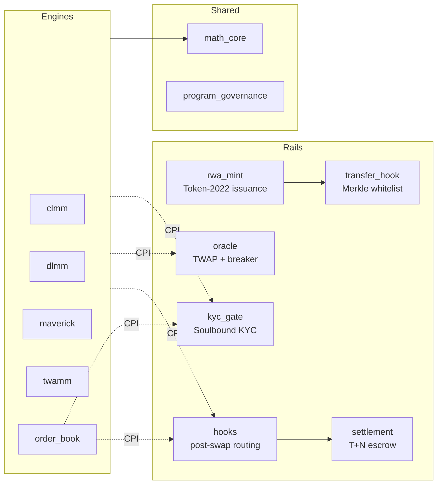

# Feature Specification — Solana RWA DEX

A complete, feature-by-feature specification of the Solana RWA DEX: all eleven
on-chain programs, the shared Rust libraries, the web trading console, the
off-chain service placeholders, and the build/test/deploy tooling.

**Audience:** smart-contract engineers and auditors. Each feature states what it
does, the mechanism that implements it, the accounts/instructions that expose it,
the guards that constrain it, and where it is verified.

**How this document relates to the other docs**

| Document | Relationship |
| :--- | :--- |
| [`architecture.md`](architecture.md) | System topology and end-to-end trade lifecycle. This document is the feature-level companion. |
| [`risk.md`](risk.md) | The risk taxonomy and five-tier control model that these features implement. |
| [`trading-strategies.md`](trading-strategies.md) | How each AMM feature is used by market makers and traders. |
| [`security-review.md`](security-review.md) | Findings (D-1, H-1, M-1…M-9, L-1…L-8) and the invariants that resulted. |
| `programs/<name>/README.md` | Per-program deep dives: full account structs and error tables. |

> Counts quoted as "reported" (test totals, build status) come from the
> repository READMEs and were not re-executed while authoring this document.
> Everything else — instruction names, PDAs, constants, guards — was read from
> the source tree.

---

## Table of contents

- [1. Feature map](#1-feature-map)
- [2. Program inventory](#2-program-inventory)
- [3. On-chain features](#3-on-chain-features)
  - [3.1 Token-2022 RWA issuance — `rwa_mint`](#31-token-2022-rwa-issuance--rwa_mint)
  - [3.2 Transfer-hook whitelist — `transfer_hook`](#32-transfer-hook-whitelist--transfer_hook)
  - [3.3 Soulbound KYC gate — `kyc_gate`](#33-soulbound-kyc-gate--kyc_gate)
  - [3.4 TWAP oracle & circuit breaker — `oracle`](#34-twap-oracle--circuit-breaker--oracle)
  - [3.5 T+N settlement clearinghouse — `settlement`](#35-tn-settlement-clearinghouse--settlement)
  - [3.6 Post-swap settlement hook — `hooks`](#36-post-swap-settlement-hook--hooks)
  - [3.7 CLMM engine — `clmm`](#37-clmm-engine--clmm)
  - [3.8 DLMM engine — `dlmm`](#38-dlmm-engine--dlmm)
  - [3.9 Maverick DDAMM engine — `maverick`](#39-maverick-ddamm-engine--maverick)
  - [3.10 TWAMM engine — `twamm`](#310-twamm-engine--twamm)
  - [3.11 Limit order book — `order_book`](#311-limit-order-book--order_book)
- [4. Shared library features](#4-shared-library-features)
  - [4.1 `math_core`](#41-math_core)
  - [4.2 `program_governance`](#42-program_governance)
- [5. Cross-cutting protocol features](#5-cross-cutting-protocol-features)
- [6. Web console features](#6-web-console-features)
- [7. Off-chain services & infrastructure](#7-off-chain-services--infrastructure)
- [8. Tooling, testing & deployment](#8-tooling-testing--deployment)
- [9. Feature status matrix](#9-feature-status-matrix)
- [10. Known gaps & roadmap](#10-known-gaps--roadmap)

---

## 1. Feature map

The protocol is best understood as **compliance rails** (who may hold, trade,
and settle) wrapped around **four AMM engines and a limit order book** (how price
is discovered), all sharing one math library and one authority model.



| # | Feature | Owner | Status |
| :-- | :--- | :--- | :--- |
| F1 | Permissionless Token-2022 RWA mint factory (hook + metadata + delegate + fee) | `rwa_mint` | Implemented |
| F2 | Dual-proof RFC-6962 Merkle whitelist on every transfer | `transfer_hook` | Implemented |
| F3 | Soulbound, revocable institutional KYC attestations + pre-trade CPI gate | `kyc_gate` | Implemented |
| F4 | 100-slot TWAP ring buffer, deviation guard, permissionless circuit breaker | `oracle` | Implemented |
| F5 | T+N escrow with secp256k1 Transfer Agent release + constrained refunds | `settlement` | Implemented |
| F6 | Post-swap hook routing AMM output into settlement | `hooks` | Implemented |
| F7 | Concentrated liquidity with bitmap-verified tick walk | `clmm` | Implemented |
| F8 | Discrete zero-slippage bins with dynamic fees | `dlmm` | Implemented |
| F9 | Directional, self-migrating bins with move-chain withdrawals | `maverick` | Implemented |
| F10 | Time-sliced block orders with virtual netting | `twamm` | Implemented |
| F11 | Q64.64 / U256 math and CLMM primitives | `math_core` | Implemented |
| F12 | Upgrade-authority gated one-time initializers | `program_governance` | Implemented |
| F13 | Optional KYC / oracle / settlement "wiring rails" per AMM pool | all AMMs | Implemented |
| F14 | Non-trapping pause invariant | all AMMs + settlement | Implemented |
| F15 | Wallet-integrated trading console: one page per protocol, demo mode, RBAC and multisig staging | `app/web` | Implemented |
| F16 | Localnet bootstrap: build + deploy + seed + self-check swap | `app/web` + `scripts` | Implemented |
| F17 | Off-chain indexer / oracle keeper / analytics | `services/*` | Placeholder |
| F18 | Shared TS package for the protocol + frontend | `packages/shared` | Placeholder |
| F19 | Docker / ops configuration for local, devnet, prod | `infra` | Placeholder |
| F20 | Resting limit orders with partial fills, isolated escrow, KYC gate and optional T+N routing | `order_book` | Implemented |

---

## 2. Program inventory

Program IDs are cluster-independent: they are baked into each crate's
`declare_id!` and into the keypairs under `target/deploy`, so client PDAs do not
change between `localnet`, `devnet` and `mainnet-beta`.

| Program | Program ID | Role |
| :--- | :--- | :--- |
| `clmm` | `GKvqhzy7V6MN8YRuQchWahMJLG4cbHWdWzEWyoSG1XNU` | Uniswap-v3-style concentrated liquidity |
| `dlmm` | `5JPnmJouZ3yE9Xwaacjtr5F2E1ShYGxJ1mR4UV9EFE3c` | Discrete bin dynamic liquidity |
| `hooks` | `B5thQMyLNmPsgWVnsscaP4BFUMVW7QFwnufiJKq6Y1DA` | Post-swap escrow routing |
| `kyc_gate` | `7Tqk6HWJcnEPAdNdRy4ZfqreaNuT9nqFSCLdnLCYnDK1` | Soulbound KYC attestations |
| `maverick` | `9hQXDPwodmaTZYaAEDVE8EWRKb3d39Wr2Lb3zFgSaBW4` | Directional dynamic-distribution AMM |
| `oracle` | `4ENC2RRJGUhttqMvqztBBFtP7dn3cvMQZvgfBG1pmFoj` | TWAP + circuit breaker |
| `order_book` | `3ACX2Lc67uZW65PA3QbYRLttmxE766eSDyD9Sd2yggwD` | Limit orders + partial fills |
| `rwa_mint` | `5GbeJh4sySASsdH2zRdFX85LuXnu5y3rBkqhVi76Lzho` | Token-2022 RWA mint factory |
| `settlement` | `58sKC5UqKZrMrSj5bGoEdyfwbckm2CwvrHPDCbESoLJ6` | T+N escrow clearinghouse |
| `transfer_hook` | `fo9ANuG3MfLiiQcqipXLNaSoPoMyp4ArAzJtwNbhxNS` | Merkle whitelist transfer hook |
| `twamm` | `FeApqgNan2ifjbhzK1dvDJxdEM45xEEgFJPpCzKr72H9` | Time-weighted average market maker |

Shared libraries (not deployed; compiled into the programs):

- **`libs/math_core`** — Q64.64 fixed point, U256, tick/sqrt-price math, swap steps.
- **`libs/program_governance`** — `require_upgrade_authority`.

---

## 3. On-chain features

Each subsection follows the same shape: **purpose → instructions → mechanisms &
guards → PDAs → verification.**

### 3.1 Token-2022 RWA issuance — `rwa_mint`

**Purpose.** Create and manage SPL Token-2022 mints purpose-built for
tokenized real-world assets: regulatory restrictions enforced by the token
standard itself rather than by a wrapper contract.

**Instructions**

| Instruction | Signature | Notes |
| :--- | :--- | :--- |
| `create_rwa_mint` | `(params: RwaMintParams)` | Permissionless factory; creates the account, initializes extensions, base mint and embedded metadata. |
| `mint_to` | `(amount: u64)` | Mint-authority only. |
| `transfer` | `(amount)` | Moves the tokens through `transfer_checked` with the hook's accounts (the hook program id, meta list, both `WhitelistEntry` PDAs, config) in `remaining_accounts`. Nothing is appended to the data: Token-2022 builds the hook's own data and requires an exact length. |
| `update_transfer_fee` | `(new_fee_basis_points: u16, new_maximum_fee: u64)` | Fee-authority only. |

**Enabled Token-2022 extensions**

| Extension | Feature enabled |
| :--- | :--- |
| `TransferHook` | Binds the mint to the whitelist hook program. |
| `MetadataPointer` | Points the metadata interface at the mint itself. |
| `TokenMetadata` | Embeds name / symbol / URI (ISIN, CUSIP, prospectus, NAV). |
| `PermanentDelegate` | Regulatory seizure / recovery authority (bypasses owner signature). |
| `TransferFeeConfig` | Basis-point fee with a maximum cap, claimed by the fee authority. |
| `NonTransferable` (optional) | Soulbound tokens (used by `kyc_gate`). |

**Mechanisms & guards**

- **Dynamic sizing.** Mint length is not constant, so the account is created by
  hand, not `#[account(init)]`:
  `space = ExtensionType::try_calculate_account_len::<SplMint>(&MINT_EXTENSIONS) + TokenMetadata::tlv_size_of(metadata)`.
  The four fixed extensions total 284 TLV bytes → **450-byte** base; metadata is
  `92 + |name| + |symbol| + |uri|`. Both numbers are pinned by unit tests.
- **Metadata is funded up front.** The token program's variable-length TLV
  writer assumes rent is already covered, so `create_rwa_mint` funds
  `Rent::minimum_balance(mint_space)`.
- **Strict extension ordering.** Hook → metadata pointer → permanent delegate →
  transfer fee → `initialize_mint2` → metadata. Wrong order fails at the token
  program.
- **Eight distinct authorities** can be installed on one mint (mint, freeze,
  metadata update, metadata pointer, permanent delegate, fee config, withdraw
  withheld, transfer hook). The permanent delegate is the sharpest and should be
  a multisig/PDA in production.
- **Hook-account forwarding.** `transfer` builds a plain `transfer_checked`
  (nothing appended — Token-2022 requires an exact data length and builds the
  hook's own data itself) and forwards the mint's `extra-account-metas` PDA, the
  sender's and the recipient's `WhitelistEntry` PDAs, and the `transfer_hook`
  config in `remaining_accounts`. Both stored proofs must fold to the published
  root.
- **Transfer-fee math.** `fee = min(ceil(amount × bps / 10_000), maximum_fee)`;
  the destination nets `amount − fee`; withheld fees stay in the destination
  account until the withdraw-withheld authority sweeps them with
  `@solana/spl-token`.
- **No fee-claim instruction** exists in-program by design — sweeping is done
  with the standard token helpers.

**PDAs / accounts.** No PDAs; the mint is a keypair account the authority signs.
`Transfers` use `InterfaceAccount<Mint>` / `InterfaceAccount<TokenAccount>` so
both SPL Token and Token-2022 are accepted.

**Verification.** `programs/rwa_mint/README.md` documents the sizing constants
(450 / 92) pinned by unit tests; end-to-end coverage; failure-mode table.

---

### 3.2 Transfer-hook whitelist — `transfer_hook`

**Purpose.** Enforce that **both** the sender and the recipient of an RWA token
are whitelisted institutions, on every transfer, with the whitelist committed as
a single 32-byte Merkle root and each institution's path carried in its own
`WhitelistEntry` PDA (the only carrier Token-2022 offers — see the known-gap note
that this closed).

**Instructions**

| Instruction | Signature | Notes |
| :--- | :--- | :--- |
| `initialize` | `()` | Creates the `Config` PDA; upgrade-authority gated. |
| `update_root` | `(new_root: [u8; 32])` | Authority only; zero root rejected. |
| `set_paused` | `(paused: bool)` | Authority only; halts all transfers. |
| `set_authority` | `(new_authority: Pubkey)` | Authority only; default pubkey rejected. |
| `initialize_extra_account_meta_list` | `()` | Registers the two `WhitelistEntry` PDAs (derived from the token accounts' owners) and the `Config` PDA as extra accounts for a mint; requires the mint to point at this hook. |
| `set_whitelist_entry` | `(proof: Vec<[u8; 32]>)` | Authority only; creates or refreshes one institution's entry (`init_if_needed`). The path must fold to the live root (`ProofNotInWhitelist`), at most 20 nodes (`ProofTooLong`). |
| `close_whitelist_entry` | `()` | Authority only; delists an institution and refunds the entry's rent. |
| `execute` | `(_amount)` | The SPL hook entrypoint, invoked by Token-2022. Data is the amount and nothing else. |

**Mechanisms & guards**

- **RFC-6962 domain separation.**
  `leaf = keccak256(0x00 ‖ wallet)`,
  `parent(a,b) = keccak256(0x01 ‖ min(a,b) ‖ max(a,b))`. Prefixes make leaves and
  inner nodes disjoint preimages; sorted pairs remove left/right position bits.
- **Dual verification.** `execute` folds the **source** entry's path first
  (`SourceNotWhitelisted`) and the **destination** entry's path second
  (`DestinationNotWhitelisted`). A delisted holder cannot sell out.
- **Owners come from the token accounts**, never a caller-supplied key (the
  `owner` signer is constrained), and each entry must be the one for the wallet
  it proves for (`InvalidWhitelistEntry`) — Token-2022 derives the entry address
  from `source_token.owner` / `destination_token.owner`, but `execute` is a public
  instruction too, so the binding is re-checked rather than assumed.
- **Proofs arrive as accounts, not instruction data.** Token-2022 constructs the
  hook's data itself (`[SPL_DISC][amount u64]`) and forwards no trailing bytes, so
  the mint's `ExtraAccountMetaList` resolves `[b"whitelist", owner]` for both
  token accounts with `Seed::AccountData` at offset 32 (the `owner` field of the
  base token-account layout). A wallet with no entry cannot be a party to a
  transfer at all: Token-2022 has no account to resolve and the transaction fails
  before the hook runs.
- **Paused / uninitialized guards.** `WhitelistPaused` and
  `WhitelistNotInitialized` precede proof checks.
- **Correct dispatch.** The handler overrides Anchor's sighash with the
  `sha256("spl-transfer-hook-interface:execute")[..8]` tag Token-2022 actually
  sends; the old Anchor tag no longer dispatches.
- **Sizing.** An entry is 681 bytes (8 + 32 owner + 1 depth + 20 × 32 proof
  slots) — roughly 0.0048 SOL of rent, refunded on `close_whitelist_entry`. Paths
  longer than `MAX_PROOF_DEPTH` (20, ≈ a million institutions) cannot be stored,
  so deeper whitelists are sharded per jurisdiction, one registration each.
- **Rotation semantics.** A new root leaves every entry in place and revokes every
  one whose path no longer folds to it: revocation is immediate and cannot be
  forgotten, and re-granting is `update_root` followed by one
  `set_whitelist_entry` per member. `set_whitelist_entry` is an upsert for exactly
  this reason.
- **Zero-root rule.** `update_root` refuses the all-zero root because it doubles
  as "no whitelist yet"; use `set_paused` to take transfers out of service.

**PDAs / accounts**

| Account | Seeds |
| :--- | :--- |
| `Config` | `[b"config"]` |
| `ExtraAccountMetaList` | `[b"extra-account-metas", mint]` |
| `WhitelistEntry` | `[b"whitelist", owner]` |

`Config` is 74 bytes: `authority (32) · merkle_root (32) · bump (1) · paused (1)`.
`WhitelistEntry` is 681 bytes: `owner (32) · depth (1) · proof (20 × 32)`.

**Verification.** 19 unit tests in `cargo test -p transfer_hook` (the meta list
resolving to each side's entry PDA and the config, dual-approval,
source-only failure, destination-only failure, entry bound to the wrong wallet,
uninitialized root, paused, un-prefixed proof rejection, duplicate-node tree, tag
dispatch, zero root, pause, rotation, the write-time gate on
`set_whitelist_entry`, and the mint check).

**Closed gap — the proofs could not reach `execute`.** Token-2022 builds the
hook's instruction data itself in
`spl_transfer_hook_interface::onchain::invoke_execute` (`[SPL_DISC][amount u64]`)
and forwards **no** trailing bytes from the transfer, so a transfer had no way to
deliver `source_proof` / `destination_proof`; appending them to the
`transfer_checked` data made Token-2022 reject the whole instruction
(`InvalidInstructionData` — it requires an exact data length), and whitelist
enforcement was unreachable. The proofs now travel as per-institution
`WhitelistEntry` PDAs resolved through the `ExtraAccountMetaList`, and both
`tests/ts/rwa-dex.ts` (approved transfer, unregistered destination, proof
rejected at write time, stale entry after a rotation) and the localnet
bootstrap's RWA self-check exercise the real path.

---

### 3.3 Soulbound KYC gate — `kyc_gate`

**Purpose.** Put the answer to "is this wallet an approved institution?" **in the
institution's own wallet**, as a non-transferable Token-2022 token a pool can
verify with accounts a swap already carries.

**Instructions**

| Instruction | Signature | Notes |
| :--- | :--- | :--- |
| `initialize_kyc_mint` | `()` | Creates config + attestation mint; upgrade-authority gated. |
| `issue_kyc` | `()` | Mints exactly 1 token; authority only; account must be empty. |
| `revoke_kyc` | `()` | Burns the attestation via the permanent delegate; holder need not sign. |
| `verify_kyc` | `()` | Read-only, permissionless pre-trade check (trader must sign). |
| `set_authority` | `(new_authority: Pubkey)` | Rotates the role; default pubkey rejected. |

**Mechanisms & guards**

- **Soulbound by the token program.** The mint carries `NonTransferable`, so no
  code path can move an attestation to an unapproved wallet.
- **Revocable without cooperation.** The mint's `PermanentDelegate` is the
  `KycConfig` PDA, so `revoke_kyc` burns an attestation without the holder.
- **One token per institution.** `issue_kyc` requires an empty account
  (`AlreadyApproved`); `revoke_kyc` burns exactly one and requires one
  (`NotKycApproved`).
- **Mint / freeze / delegate authorities are the config PDA** — no wallet can
  mint or burn outside the instructions.
- **Account extensions required by the token program:** the mint is 206 bytes
  (`NonTransferable` + `PermanentDelegate` TLVs); accounts need `ImmutableOwner`
  + `NonTransferableAccount` (174 bytes). Older ATA programs that size only the
  base account fail with `NonTransferableNeedsImmutableOwnership`.
- **`verify_kyc` checks three fields in order:** mint (`WrongMint`), owner
  (`WrongOwner`), amount ≥ 1 (`NotKycApproved`); the trader must sign.

**PDAs / accounts**

| Account | Seeds | Notes |
| :--- | :--- | :--- |
| `KycConfig` | `[b"kyc-config"]` | `authority · kyc_mint · bump · mint_bump` (74 bytes). |
| Attestation mint | `[b"kyc-mint"]` | Token-2022 mint, 206 bytes. |

Both are singletons: one deployment, one DEX, one KYC set.

**Verification.** 6 unit tests (policy outcomes, account sizes) + 9 e2e tests in
LiteSVM against the real Token-2022 image (mint layout, account extensions,
upgrade-authority gate, binary issuance, rotation, non-transferability).

---

### 3.4 TWAP oracle & circuit breaker — `oracle`

**Purpose.** Refuse RWA trades priced off spot when spot has diverged from a
time-weighted average, and provide a latch that pauses a deviating pool in a
transaction that **succeeds**.

**Instructions**

| Instruction | Signature | Notes |
| :--- | :--- | :--- |
| `initialize` | `(max_deviation_bps: u16, owner: Pubkey)` | Pool PDA must sign; creates the per-pool state atomically with the pool. |
| `record_observation` | `(sqrt_price_x64: u128)` | Pool PDA only; appends to the ring buffer. |
| `get_twap` | `(seconds_ago: u32) -> Option<u128>` | Read-only view. |
| `check_deviation` | `(current_sqrt_price_x64: u128)` | The guard; reverts a swap, writes nothing. |
| `trip_breaker` | `(current_sqrt_price_x64: u128)` | The latch; permissionless via the pool; sets `is_paused = 1`. |
| `unpause_pool` | `()` | Owner only. |

**Mechanisms & guards**

- **100-observation ring buffer** of `(timestamp, sqrt_price_x64, cumulative)`.
- **Genesis-based accumulator.** `cumulative += last_price × Δt` (only while the
  price is known); TWAP over `[t₀, now]` = `(cum_now − cum_t₀) / (now − t₀)`, with
  linear interpolation at the boundary and extrapolation to `now`.
- **Pool-authenticated writes and checks.** Every instruction that consumes a
  caller-supplied price requires the pool PDA as a signer and matches it to
  `oracle_state.pool` (`UnauthorizedPool`). A forged price cannot pause a healthy
  pool or fake a check.
- **Created atomically with the pool** — no front-running window for a hostile
  threshold or unpause owner (`InvalidThreshold`, `InvalidOwner`).
- **Graceful cold start.** With no meaningful history the check is skipped (with
  a log), not failed — trading is not blocked forever.
- **Revert vs. latch.** `check_deviation` reverts the guarded swap but cannot
  persist state; `trip_breaker` persists the pause in its own successful
  transaction. Only pause, never unpause.
- **Timestamps, not slots** (`Clock::unix_timestamp`); backwards time is
  rejected (`TimestampMovedBackwards`).
- **Sqrt-price semantics.** Thresholds are sqrt-price bps; a true-price
  threshold `T` should be passed as ≈ `T/2`.

**PDAs / accounts.** `OracleState` = `[b"oracle", pool]`, 4078 bytes, one per
pool.

**Verification.** Unit tests over the ring buffer and accumulator math; e2e suite
`tests/e2e/tests/oracle.rs` pins genesis layout, ring wrap, TWAP values, the
`Option<u128>` return, pool-signer rules, and the
`check_deviation → trip_breaker → unpause_pool` lifecycle.

---

### 3.5 T+N settlement clearinghouse — `settlement`

**Purpose.** Mirror institutional T+1/T+2 clearing: swap output is escrowed and
released only after a time lock **and** an off-chain Transfer Agent's secp256k1
signature.

**Instructions**

| Instruction | Signature | Notes |
| :--- | :--- | :--- |
| `initialize` | `(pools_require_gate: bool)` | Upgrade-authority gated; fixes the initiation policy. |
| `set_hooks_authority` | `(hooks_authority: Pubkey)` | Authority only; names the PDA allowed to initiate via hooks. |
| `set_transfer_agent` | `(agent_secp256k1_pubkey: [u8; 64])` | Authority only; uncompressed key; zero key rejected. |
| `initiate_settlement` | `(trade_id, settlement_slot, amount)` | Creates the vault and moves `amount` into escrow. |
| `settle` | `(signature: [u8; 64], recovery_id: u8)` | Permissionless; no signer required. |
| `cancel_settlement` | `()` | Config authority or initiating pool; refunds only to `refund_source`. |
| `refund_expired` | `()` | Permissionless after `expiry_slot`; refunds only to `refund_source`, marks `Expired`. |
| `close_settlement` | `()` | Config authority; closes a terminal trade's empty escrow + vault, returning rent. |
| `set_mint_agent` | `(agent_secp256k1_pubkey: [u8; 64])` | Authority only; installs/updates the `[b"agent", mint]` override. |
| `clear_mint_agent` | `()` | Authority only; closes the override, reverting the mint to the global key. |

`initiate_settlement`, `settle`, `cancel_settlement` and `refund_expired` take the mint's **transfer-hook accounts** in `remaining_accounts`, and `settle` / `cancel_settlement` take a `token_mint` account (the vault's own mint) — see the Token-2022 note below. `settle` additionally takes the optional `[b"agent", mint]` account (the program ID is the `None` sentinel).

**Mechanisms & guards**

- **Two independent gates inside a closed window.** Release needs
  `settlement_slot <= Clock::slot < expiry_slot` **and** a low-s signature that
  recovers to the agent key for the mint (a per-mint override when passed,
  otherwise the config's global key). Either gate alone is inert.
- **Hard deadline.** `expiry_slot = settlement_slot + 216 000` slots (a program
  constant). Past it `settle` fails (`SettlementExpired`) and anyone may call
  `refund_expired`, which pays only the vault's `refund_source` (`SettlementNotExpired`
  before the deadline). No `Pending` escrow can be stranded.
- **Message binding.** The agent signs
  `keccak256(trade_id (8 LE) ‖ taker (32) ‖ mint (32) ‖ amount (8 LE))` — all read
  from the vault, not from instruction arguments, so a signature is valid for
  exactly one trade. `keccak256` of the raw preimage; **not** `personal_sign`.
- **Key format.** 64-byte uncompressed secp256k1 (`x ‖ y`), not compressed (33 B)
  and not an Ethereum address (20 B).
- **Measured amount.** `amount` is stated and checked against the source balance,
  then the escrow's own balance delta is recorded, so it is what actually landed
  (`InvalidSettlementAmount`, `EmptySettlement`).
- **Initiation policy (`pools_require_gate`).** When set, trades must be
  initiated either by a wired AMM pool (`UnauthorizedPool`) or by the hooks
  authority; wallet-initiated trades are refused (`GateRequired`).
- **Pinned payout / refund.** `taker_token_account` must be owned by the vault's
  recorded `taker` (`InvalidTakerTokenAccount`); `cancel_settlement` refunds only
  to the recorded `refund_source` (`InvalidRefundAccount`) — the H-1 remediation.
- **Trade ids are forever.** The vault PDA `init` makes every id single-use for
  the program's lifetime, even after settle/cancel.
- **Token-2022, checked transfers.** Every move is `transfer_checked` with the mint attached. The
  legacy `Transfer` CPI is refused by Token-2022 for any account of a mint carrying the
  transfer-hook extension (`MintRequiredForTransfer`, 0x1f), and RWA mints always carry one — which
  is why `settle` and `cancel_settlement` take a `token_mint` account (pinned to the vault's mint).
- **Transfer-hook accounts are forwarded.** Token-2022 resolves the mint's `ExtraAccountMetaList`
  against the *transfer instruction's* account list and fails with `IncorrectAccount` when one is
  missing, and it only passes on the accounts the instruction carries — so the hook program, the
  meta list, both sides' `WhitelistEntry` PDAs and the hook config are appended from the
  caller's `remaining_accounts`. Because the hook checks **both** sides and derives each entry from
  its token account's `owner`, the fixed `[b"escrow_authority"]` PDA must itself be a whitelist
  member: escrowing an RWA mint is one `transfer_hook::set_whitelist_entry` for the escrow plus an
  entry for the funder. That one escrow entry covers every trade, since every escrow token account
  is owned by the same PDA.
- **No events.** State transitions are `msg!`-logged only.

**PDAs / accounts**

| Account | Seeds | Size |
| :--- | :--- | :--- |
| `SettlementConfig` | `[b"config"]` | 138 B (`authority · transfer_agent_secp256k1 · pools_require_gate · hooks_authority · bump`). |
| `SettlementVault` | `[b"settlement", trade_id_le]` | 170 B (`trade_id · taker · token_mint · amount · settlement_slot · expiry_slot · status · pool · refund_source · bump`). |
| `MintAgentKey` | `[b"agent", mint]` | 73 B (`transfer_agent_secp256k1 · bump`). Optional per-mint override. |

`SettlementStatus` = `Pending | Settled | Cancelled | Expired` (everything but `Pending` is terminal).

**Time-lock reference** (≈2.5 slots/s): T+100 ≈ 40 s, T+1 day ≈ 216 000 slots (the expiry window).

**Verification.** TS integration suite (`tests/ts/rwa-dex.ts`) drives the three token moves
against a hook-gated Token-2022 RWA mint: escrow creation (asserting the vault records what the
escrow received), the time lock (`SettlementPeriodNotOver`), a signature-verified release with a
real secp256k1 signature, and a compliance refund — all passing. The suite whitelists the
fixed `[b"escrow_authority"]` PDA alongside the institutions, which is what the hook requires. The seeder runs
the same three instructions plus a `set_mint_agent` → `clear_mint_agent` round trip through the web
client against a plain SPL mint. Unit tests cover the low-s predicate, the account sizes and the
expiry arithmetic. No Rust e2e suite, and no end-to-end test of `refund_expired` / `close_settlement`
(reaching expiry needs 216 000 slots) — the remaining gap.

---

### 3.6 Post-swap settlement hook — `hooks`

**Purpose.** The "Uniswap v4-style hook" that captures AMM output at trade time
and pushes it into the settlement escrow instead of paying the taker directly.

**Instructions**

| Instruction | Signature | Notes |
| :--- | :--- | :--- |
| `after_swap` | `(trade_id, settlement_slots, amount)` | Derives the vault, computes the absolute slot, CPIs `settlement::initiate_settlement`. |
| `fund_hook_authority` | `(lamports: u64)` | Permissionless; tops up the PDA that pays vault rent. |

**Mechanisms & guards**

- **Derived authority, not a declared signer.** `hook_authority` is the PDA
  `[b"hook_authority"]`; its seeds are what make "the hook" non-spoofable.
- **Custody pinned by derivation.** `amm_vault` must be exactly
  `get_associated_token_address_with_program_id(hook_authority, mint, token_program)`
  (`InvalidCustodyAccount`). Ownership alone is insufficient: anyone can create a
  token account owned by a PDA without its signature.
- **Settlement vault pinned by seed** (`InvalidSettlementVault`), escrow token
  account pinned to the settlement program's `[b"escrow", trade_id_le]` PDA
  (`InvalidVaultTokenAccount`), mint agreement (`MintMismatch`).
- **Relative → absolute T+N.** The hook turns `settlement_slots` into
  `Clock::slot + N` (`SettlementSlotOverflow` on overflow).
- **Explicit, bounded amount.** `amount` must be > 0 and ≤ the custody balance
  (`InvalidAmount`), so a trade cannot sweep unrelated leftovers.
- **Stateless.** No state accounts; observability is via settlement vault PDAs.
- **No caller access control** on `after_swap` — the account set is the
  constraint.

**PDAs / accounts.** `HookAuthority` = `[b"hook_authority"]` (a system account
carrying lamports, no data layout).

**Verification.** `after_swap` forwards the caller's `remaining_accounts` into the settlement
CPI, which is how the escrow leg of a hook-gated (RWA) mint gets its hook accounts; the seeder's
CLMM rail check (`bun run bootstrap:localnet --rails oracle,settlement`) routes a real swap into
T+N escrow through it. Automated `after_swap` coverage in `tests/e2e` is a documented next step.

---

### 3.7 CLMM engine — `clmm`

**Purpose.** Uniswap-v3-style concentrated liquidity for pegged/correlated RWA
pairs (tokenized T-bills, stablecoins), with a **bitmap-verified** tick walk.

**Instructions**

| Instruction | Notes |
| :--- | :--- |
| `initialize_pool` | Price, tick spacing, fee, and the optional rails. |
| `add_liquidity` | `init_if_needed` ticks and position; rounded-up deposits. |
| `remove_liquidity` | Floors checked before any write. |
| `collect_fees` | Claim-style fee withdrawal. |
| `swap` | Walks supplied ticks; partial fills allowed. |
| `trip_breaker` | Permissionless oracle latch via the pool. |
| `set_paused` / `set_authority` | Admin: pause trading, rotate authority. |

> Note: the pool has two independent halts — the admin `set_paused` (pool
> authority) and the oracle `trip_breaker` latch (unpaused by the oracle owner).
> Neither blocks withdrawals or fee collection. `set_authority` rotates the pool
> authority.

**Mechanisms & guards**

- **Continuous Q64.64 curve.** `sqrt_price_x64`; ticks via
  `S(t) = 1.0001^(t/2)·2^64`, ticks in `[−443 636, 443 636]`.
- **Bitmap-verified walk.** Remaining tick accounts must be the *next*
  initialized ticks in the walk direction, checked against the pool's tick
  bitmap (`TicksNotInOrder`, `WrongTickAccount`, `TickNotWritable`). A caller
  cannot skip a tick to avoid a liquidity change.
- **Exact fee accounting.** Fee recomputed on the input each step actually
  consumed: `ceil(in × f / (1_000_000 − f))`; budget identity `in + fee ≤ offered`
  is asserted across fee tiers and inputs 0–5 000.
- **Partial fills, never reverts on depth** — unspent input stays in the wallet.
- **Asymmetric rounding** — deposits up, withdrawals/swap outputs down.
- **Claim-style fee growth** via global accumulators and per-tick outside
  mirrors (`tokens_owed`).
- **Tick bitmap sizing.** `BITMAP_BITS_MAX = 65 536`, floor `tick_spacing = 14`
  (`TickSpacingTooFine`), which keeps a pool inside one 10 KiB account.
- **Token-2022 aware.** `InterfaceAccount`/`Interface<TokenInterface>`
  throughout, so a pool's mints may be issued under either token program; the
  vaults are created through whichever one the pool was initialized with, and
  hook accounts arriving after the tick walk are forwarded into every transfer.
- **Exact receipts, fees grossed up.** A mint that carries a Token-2022
  `TransferFee` extension has its inbound transfers grossed up by the fee in
  force (`calculate_pre_fee_amount`), so the vault nets exactly the amount the
  curve priced and the depositor/trader pays the token's fee. The vault's balance
  delta is still measured: a shortfall refuses the transfer
  (`TransferAmountMismatch`) rather than crediting the pool with liquidity it
  never received. Payouts are debited exactly, never grossed up.
- **Rails.** KYC + oracle + settlement wired per pool (see §5.1).

**PDAs**

| Account | Seeds |
| :--- | :--- |
| `Pool` | `[b"clmm-pool", mint_a, mint_b]` |
| `Vault A/B` | `[b"clmm-vault-a"/"b", pool, mint]` |
| `TickState` | `[b"clmm-tick", pool, tick_le]` (little-endian i32) |
| `Position` | `[b"clmm-pos", pool, owner, lower_le, upper_le]` |

**Verification.** Extensive unit tests (fee formula, growth arithmetic, position
splits, tick bookkeeping, spacing floor, bitmap scans) + e2e suite
`tests/e2e/tests/clmm.rs` (bitmap set/clear, walk rejection, crossing
bookkeeping, collect/withdraw, a full deposit-and-swap round trip on a
Token-2022 pool, a 1% fee mint's deposit and swap each netting the exact priced
amount with the fee paid on top, the same holding after the issuer raises the fee
on a funded pool, and each rail against its real program).

---

### 3.8 DLMM engine — `dlmm`

**Purpose.** Discrete price bins for volatile/uncorrelated RWA pairs, with
**zero slippage inside a bin** and a utilization-scaled dynamic fee.

**Instructions**

| Instruction | Notes |
| :--- | :--- |
| `initialize_pool` | Bin step, base fee, active bin, plus rails. |
| `initialize_bin_array` | Permissionless array creation within `MAX_BIN_ARRAY_SPAN`. |
| `add_liquidity` / `remove_liquidity` | Per-bin LP shares; withdrawals keep working while paused. |
| `swap` | Walks bin arrays; rails run around the bin math. |
| `trip_breaker`, `set_paused`, `set_authority` | Oracle latch + admin. |

**Mechanisms & guards**

- **Bin price** `P_whole = 1.0001^(bin_id × bin_step)`, raw price scaled by
  `10^(decimals_a − decimals_b)` (`MAX_MINT_DECIMALS = 9`).
- **Zero slippage in a bin**; drains a bin to exactly zero (`in_needed` rounds
  up, outputs round down).
- **70 bins per `BinArray`**, Euclidean indexing so negative ids map to negative
  arrays.
- **Dynamic fee** `base_fee_bps × (1 + utilization/100)`; 50% balanced, 90%
  one-sided. Fee is taken from what actually arrived.
- **Token-2022 aware.** `transfer_and_measure` handles transfer fees in flight;
  transfer-hook accounts pass through `remaining_accounts`.
- **Constants:** `MAX_BIN_STEP = 100`, `MAX_BASE_FEE_BPS = 100`,
  `MAX_BIN_ARRAY_SPAN = 16`.
- **Rails + non-trapping pause + oracle price recomputation** (a pure function
  proven equal to what the array stores).

**PDAs**

| Account | Seeds |
| :--- | :--- |
| `Pool` | `[b"pool", mint_a, mint_b]` |
| `Vault A/B` | `[b"vault_a"/"b", pool, mint]` |
| `BinArray` | `[b"bin_array", pool, index_le]` |
| `Position` | `[b"position", pool, owner, bin_id_le]` |

**Verification.** Unit tests for quoting/rounding and the `in_needed(quote(x)) ≤ x`
property over inputs 1–5 000; e2e suite `tests/e2e/tests/dlmm.rs`.

---

### 3.9 Maverick DDAMM engine — `maverick`

**Purpose.** Bins that **move with the price**, so out-of-range LP capital is
redeployed next to the price it will trade at — without a swap and without
diluting existing LPs.

**Instructions**

| Instruction | Notes |
| :--- | :--- |
| `initialize_pool` | Bin step, base fee, active bin, plus rails. |
| `initialize_bin_array` | Permissionless; within `MAX_BIN_ARRAY_SPAN`. |
| `add_liquidity` | Sets the bin's `BinKind`; moving kinds need a static baseline. |
| `remove_liquidity` | Follows the move chain; works while paused. |
| `move_bins` | Permissionless keeper relocalization. |
| `swap` | Bin walk; runs the rails. |
| `set_paused`, `set_authority`, `trip_breaker` | Admin + oracle latch. |

**Mechanisms & guards**

- **Bin kinds:** `Static` (never moves), `Right`, `Left`, `Both`.
- **Value-neutral merge.** Destination shares minted at
  `moved_value × dest_supply / dest_value`; destination value-per-share is
  unchanged to the last unit.
- **Move guards (all on-chain):** source in range → refused
  (`BinStillInRange`); direction vs. kind (`WrongMoveDirection`,
  `StaticCannotMove`); destination between source and active bin, within
  `MAX_SHIFT_BINS = 50` (`ShiftTooFar`); destination empty or same kind
  (`BinKindMismatch`); already moved (`BinAlreadyMoved`); pool not paused.
- **Move chain.** A moved bin records `{ moved, to_bin_id, share_ratio }`;
  `remove_liquidity` walks the chain (monotonicity guarded —
  `MergeChainNotMonotonic`) so LP claims are never stranded.
- **Fixed-stride layout.** `Bin::LEN = 70` bytes always; `MoveState` is
  fixed-size, so bins are addressable by `ARRAY_BINS + index × 70`. Cross-array
  reads/writes are done in place to avoid SBF heap OOM.
- **50 bins per array** (vs. DLMM's 70) because a bin carries kind + move state.
- **Rails; static baseline required before directional LPing** (`NoStaticBaseline`).

**PDAs**

| Account | Seeds |
| :--- | :--- |
| `Pool` | `[b"pool", mint_a, mint_b]` |
| `Vault A/B` | `[b"vault_a"/"b", pool, mint]` |
| `BinArray` | `[b"bin_array", pool, index_le]` |
| `Position` | `[b"position", pool, owner, bin_id_le]` (the bin deposited into) |

**Verification.** 41 unit tests (pricing, quoting, share math, dynamic fee, every
`move_bins` guard, merge value invariant, chain monotonicity, withdrawal
slicing) + e2e suite `tests/e2e/tests/maverick.rs`.

---

### 3.10 TWAMM engine — `twamm`

**Purpose.** Execute institutional block orders as a time-sliced stream of
virtual sub-orders, netting opposing flow before the embedded AMM is touched.

**Instructions**

| Instruction | Signature / notes |
| :--- | :--- |
| `initialize_pool` | Reserves + rails; no public `swap`. |
| `add_liquidity` / `remove_liquidity` | LP shares valued in token A at marginal price. |
| `create_long_term_order` | Escrows input; `sell_rate = escrow / duration`; KYC-gated. |
| `execute_virtual_orders` | Permissionless crank; nets, then trades the residual. |
| `withdraw_proceeds` | `(order_id)`; settlement-routed proceeds. |
| `cancel_order` | `(order_id)`; settles time-to-date then refunds the rest. |
| `set_paused`, `set_authority`, `trip_breaker` | Admin + oracle latch. |

**Mechanisms & guards**

- **Timestamps, not slots** — rates are raw tokens/second.
- **Escrowed, self-contained orders** — an order can never sell more than it
  escrowed.
- **Opposing flow is free.** Crossed volume trades at the marginal price with no
  AMM fee and no slippage; reserves do not move.
- **Residual to the embedded AMM** with a constant-product, 0.30%
  fee-on-input formula (`FEE_BPS = 30`).
- **Per-unit Q64.64 accumulators** (`acc_b_per_a`, `acc_a_per_b`) give O(1)
  settling per order; an order claims `sold × (acc_now − snapshot)`.
- **Expiry-sorted linked list**, verified on every walk; an expired head must be
  supplied (`MissingExpiredOrder`). Equal expiries insert after.
- **Early cancel** settles time-to-date and refunds the remainder; an expired
  order cannot be cancelled (`OrderExpired`).
- **Partial-rate refunds** for integer-division remainders.
- **`MAX_DURATION_SECONDS = 31 536 000`** (365 days).
- **Rails attach to different instructions:** KYC gates only order **creation**;
  oracle runs on `create_long_term_order`, `execute_virtual_orders` and
  `cancel_order`; settlement routes **proceeds** on `withdraw_proceeds` /
  `cancel_order` (the untraded refund is exempt).
- **Non-trapping pause** — executions and withdrawals stay open.

**PDAs**

| Account | Seeds |
| :--- | :--- |
| `Pool` | `[b"twamm-pool"]` |
| `Vault A/B` | `[b"twamm-vault-a"/"b"]` |
| `LongTermOrder` | `[b"twamm-order"]` |
| `LpPosition` | `[b"twamm-lp"]` |

**Verification.** Unit tests including the netting worked example (36 000 A vs.
72 000 B net at exactly 2.0 with reserves untouched); e2e coverage via the
CLMM/oracle harness where shared.

---

### 3.11 Limit order book — `order_book`

**Purpose.** A resting maker order that any counterparty can fill, fully or in
pieces, at a price the maker chose. The four AMMs can only trade against a pool;
the book adds the desk primitive the roadmap called out, while reusing the same
KYC and settlement rails.

**Instructions**

| Instruction | Signature | Notes |
| :--- | :--- | :--- |
| `initialize_book` | `(kyc_config, hooks_authority, settlement_slots)` | Upgrade-authority only; creates the book PDA and fixes both rails. |
| `create_order` | `(order_id, side, price, amount, expiry_timestamp)` | Escrows the maker's side into the order PDA's ATA. |
| `fill_order` | `(amount, max_counter_amount, trade_id)` | Partial or full fill; `amount` is in the escrow token. |
| `cancel_order` | `()` | Sweeps the escrow balance back to the maker and closes both accounts. |
| `set_paused` | `(paused: bool)` | Book authority only; exits stay open. |
| `set_authority` | `(new_authority)` | Book authority only; rejects the default pubkey. |

**Mechanisms & guards**

- **Per-order escrow, no shared vault.** Each order's funds sit in the order
  PDA's ATA for the side's mint, so one maker's order can never reach another's
  balance. `remaining_amount` is the order's claim on that escrow.
- **Fill denominated in the escrow token.** `amount` always means the escrow
  token (base for an ask, quote for a bid), so partial fills need no other-leg
  guess. The counter-leg is derived and rounded **in the maker's favour**: quote
  rounds up for an ask, base rounds down for a bid; a leg that rounds to zero is
  rejected (`ZeroFillLeg`).
- **Side-bound escrow mint.** The escrow mint must be the one the side escrows
  (`WrongEscrowMint`), and the escrow account must be exactly the order PDA's
  ATA for that mint and token program (`InvalidEscrowAccount`).
- **Measured deposits.** `create_order` credits the post-transfer escrow
  balance, so a Token-2022 transfer fee cannot leave the order promising more
  than it holds. A pre-funded escrow is not credited to the new order.
- **Payment before delivery.** The taker's counter-leg is transferred before the
  escrow is released, so a fill is atomic in value even across two token
  programs (RWA Token-2022 base + legacy quote).
- **State before external calls.** The order's `remaining_amount` and cumulative
  `filled_base`/`filled_quote` are written and `exit`ed before any CPI or token
  transfer, so a transfer hook re-entering the program cannot read a stale
  balance and over-fill.
- **Sweep-on-cancel.** `cancel_order` refunds the escrow's whole balance, not
  just `remaining_amount`: the escrow address is publicly derivable, anyone can
  send tokens to it, and the token program refuses to close a non-empty account.
  A one-unit donation therefore cannot brick the exit or trap the maker's funds.
- **Non-trapping exits.** Pausing refuses `create_order`/`fill_order` only, and
  expiry stops fills only; cancellation ignores pause, KYC and expiry.
- **Opt-in rails with sentinels.** KYC and settlement routing are fixed at
  `initialize_book`. A disabled rail's accounts must be the program-ID sentinel
  (`RailAccountUnexpected`); an enabled rail's accounts are address-pinned
  (canonical KYC config, hooks `[b"hook_authority"]` PDA, settlement
  config/vault/escrow PDAs, the settlement program).
- **Caller-named settlement ids.** A routed fill passes a non-zero `trade_id`
  that keys its settlement vault, exactly as the AMM swaps do; there is no
  book-wide counter, so one taker's fill cannot invalidate another's. A repeated
  id fails closed in the settlement vault's `init`.
- **Maker-bound proceeds.** The routed fill records the **maker** as the
  settlement vault's `taker`, so the Transfer Agent's secp256k1 release signature
  binds to the party that placed the order, not to whoever happened to fill it.
- **Upgrade-authority-gated markets.** The book PDA is deterministic, so only
  the program's upgrade authority can create one; a market cannot be squatted
  with a venue-uncontrolled pause key.

**PDAs / accounts.** `Book` = `[b"book", base_mint, quote_mint]` (178 bytes);
`Order` = `[b"order", book, owner, order_id_le]` (138 bytes); escrow = the order
PDA's ATA for base (ask) or quote (bid). `Book` records the pair, pause key, KYC
config, hooks authority, settlement slots and `paused`; `Order` records the side,
price, original/remaining amount, cumulative legs and expiry.

**Limits.** No matching engine, price-time queue, order crossing or routing — a
fill takes one order. No maker fee or minimum fill. No oracle/circuit breaker:
protection is the maker's price and the taker's `max_counter_amount`. No events;
indexers watch order and vault state. The book cannot be closed or migrated, and
cancellation is maker-only.

**Verification.** 5 unit tests pin the pricing legs and rounding; 10 LiteSVM
e2e cases cover partial fills, both sides, refunds, dust-proof cancellation, the
side guard, an arbitrary settlement id, the routed escrow → secp256k1 release
path, expiry, slippage and pause. See
[`programs/order_book/README.md`](../programs/order_book/README.md).

---

## 4. Shared library features

### 4.1 `math_core`

Zero-dependency, `#![no_std]`; the numerical foundation for all four engines.

| Feature | Functions / constants |
| :--- | :--- |
| Q64.64 scaling | `from_u64`, `to_u64`; `Q64 = 2^64` |
| Fixed-point arithmetic | `mul_shr`, `mul_ceil`, `div_shr`, `div_ceil` |
| Square roots | `sqrt`, `isqrt_wide`, `sqrt_price`, `price_from_sqrt_price` |
| Tick math (O(1), bit-decomposed, 19 precomputed ratios) | `sqrt_price_at_tick`, `tick_at_sqrt_price`, `MIN_TICK`/`MAX_TICK`, `MIN_SQRT_PRICE`/`MAX_SQRT_PRICE` |
| Liquidity deltas | `get_amount_0_delta`, `get_amount_1_delta`, `get_next_sqrt_price_from_amount_0/1`, `get_amount_0/1_for_amount_1/0` |
| Swap step | `compute_swap_step` → `SwapStepResult { sqrt_price_next, amount_in, amount_out, fee_amount }`; `FEE_DENOMINATOR = 1_000_000` |
| 256-bit engine (Knuth Algorithm D) | `mul_u128`, `mul_div_floor`, `mul_div_ceil`, `div_shifted` |
| Error model | `MathError { Overflow, DivByZero, TickOutOfBounds, SqrtPriceOutOfBounds, InvalidFee }` |

**Rounding policy (security-relevant):** tokens **into** the pool round **up**,
tokens **out** round **down**, fees round **up** — every operation favours the
pool.

### 4.2 `program_governance`

- **`require_upgrade_authority(program_data, expected_authority)`** parses the
  `UpgradeableLoaderState` header from the BPF loader's `ProgramData` account.
- Used by one-time initializers so the first caller cannot claim a singleton:
  `transfer_hook::initialize`, `kyc_gate::initialize_kyc_mint`,
  `settlement::initialize`. Failing signers get `UnauthorizedInitializer`.

---

## 5. Cross-cutting protocol features

These features span multiple programs and are the core of the protocol's
institutional posture.

### 5.1 Pool wiring rails (KYC · Oracle · Settlement)

Every AMM pool (`clmm`, `dlmm`, `maverick`, `twamm`) fixes an immutable **wiring
policy** at `initialize_pool`. A field left as `Pubkey::default()` disables its
rail.

| Rail | Pool field | Enabled behaviour |
| :--- | :--- | :--- |
| **KYC** | `kyc_config` | CPIs `kyc_gate::verify_kyc` for the trader before any math runs. |
| **Oracle** | `oracle_state` (or `max_deviation_bps`) | `check_deviation` pre-trade, `record_observation` post-trade, both signed by the pool PDA; `trip_breaker` available. |
| **Settlement** | `hooks_authority` + `settlement_slots` | Output is routed to the hook authority's custody ATA and escrowed (`hooks::after_swap` → `settlement::initiate_settlement`). |

**Sentinel convention.** Solana has no null account, so **a disabled rail's
accounts must be passed as the program's own ID**; anything else reverts with
`RailAccountUnexpected`. `order_book` follows the same convention per book:
KYC and settlement routing are fixed at `initialize_book`, with the canonical
PDAs and the same sentinel rule, and there is no oracle rail. The rail *program* (`kyc_program`, `oracle_program`,
`hooks_program`) must be present whenever the rail is on, or the CPI fails.

**Invariants enforced across engines:**

- The custody account is **pinned by ATA derivation** (`InvalidCustodyAccount`).
- `trade_id` is non-zero iff settlement routing is on (`InvalidTradeId`).
- `max_deviation_bps` is non-zero iff the oracle state is present
  (`InvalidOracleThreshold`).
- `settlement_slots` is non-zero iff `hooks_authority` is set
  (`InvalidSettlementSlots`).
- The oracle state is created **atomically with the pool**, signed by the pool
  PDA, so thresholds/owners cannot be front-run.
- The hook authority is passed **writable** (the settlement program charges rent
  and the escrow to it, and a CPI can only pass on privileges already held).

### 5.2 Non-trapping pause invariant

Emergency pauses halt **new exposure only**. The following exits remain
permanently callable while paused:

- `clmm::remove_liquidity`, `clmm::collect_fees`
- `dlmm::remove_liquidity`
- `maverick::remove_liquidity`
- `twamm::withdraw_proceeds`, `twamm::cancel_order`
- `order_book::cancel_order`
- `settlement::cancel_settlement`

Under no circumstance can governance trap LP or user capital.

### 5.3 Authority model & rotation safety

| Role | Program(s) | Powers |
| :--- | :--- | :--- |
| Upgrade authority | all eleven | Code upgrades; one-time initializers (`require_upgrade_authority`), including `order_book::initialize_book`. |
| Transfer Agent | `settlement` | Signs releases (secp256k1, HSM/KMS). |
| KYC authority | `kyc_gate` | Issue / revoke attestations. |
| Whitelist authority | `transfer_hook` | Publish Merkle roots; pause transfers. |
| Oracle owner | `oracle` | Unpause a tripped pool. |
| Pool authority | AMMs | Pause swaps/deposits; rotate. |
| Book authority | `order_book` | Pause the book (never cancellation); rotate itself. |

Every `set_authority` in the protocol rejects `Pubkey::default()`
(`InvalidAuthority`), which would otherwise brick administration. Rotation is
single-step by design (no handshake), so the successor may be a multisig vault
PDA that cannot sign.

### 5.4 Safety invariants (from `security-review.md`)

| Invariant | Where enforced |
| :--- | :--- |
| Pinned custody & vault accounts | `hooks`, all AMMs, `settlement` |
| Signer-bound token accounts (`token::authority`, `token::mint`) | all AMMs |
| Constrained refund destination (`refund_source`) | `settlement` (H-1 fix) |
| Per-order escrow isolation; no shared vault | `order_book` |
| Payment before delivery + state written before external calls | `order_book` |
| Sweep-on-cancel (a donation cannot brick the exit) | `order_book` |
| Sorted-pair / domain-separated Merkle proofs | `transfer_hook` |
| Checked arithmetic, `overflow-checks = true` in the release profile | `Cargo.toml` + all programs |
| Fixed-stride bin layout (SBF heap safety) | `maverick` (M-9 / L-8 fixes) |
| Upgrade-authority gating | `transfer_hook`, `kyc_gate`, `settlement` |

### 5.5 Observability

The programs intentionally define **no Anchor `#[event]` types**; state
transitions are emitted as `msg!` logs. Indexers and audit tooling must watch
**account state transitions** (vault PDAs, status fields) rather than program
events. This is a documented gap (see §10).

---

## 6. Web console features

`app/web` is a Vite + React + TypeScript institutional console run with **Bun**.
It encodes Anchor instructions directly (**no generated IDL client**).

**Architecture features**

- `src/core/borsh.ts` — minimal Borsh writer + Anchor discriminators
  (`sha256("global:<name>")`, cached).
- **Derived inputs** — the console reads linked on-chain state instead of asking
  the operator to type it: `src/core/walks.ts` derives the TWAMM
  insertion/crank/cancel walks from the expiry-linked order list and the Maverick
  withdrawal hop arrays from the bin move chain, and `src/core/merkle.ts` derives
  the RWA transfer's dual Merkle proofs from the imported whitelist and checks
  them against the published transfer-hook root.
- `src/core/pdas.ts` — every PDA derivation mirrored exactly from on-chain seeds.
- `src/core/instructions-*.ts` — one builder per program
  (`clmm`, `dlmm`, `maverick`, `twamm`, `rails`); account order matches each
  `#[derive(Accounts)]`; disabled rails use the program-ID sentinel.
- `src/core/decoders.ts` — field-exact decoders for pool / position / oracle /
  settlement vault and config / per-mint agent key / bin-array / token accounts,
  plus the Token-2022 TLV scans for the transfer-fee entry and hook program.
  `app/web/tests/decoders.test.ts` pins the TLV scans against fixed layouts.
- `src/core/connection.ts` — cluster endpoints, injected-wallet plumbing, error
  formatting, `tokenProgramForMint` (legacy SPL vs Token-2022),
  `transferFeeForMint`, and `hookAccountsForTransfers`, which resolves a mint's
  `ExtraAccountMetaList` into the hook accounts a transfer must carry. The four
  AMM pages and the settlement form resolve the token program (and, for a hook
  mint, the hook accounts) before deriving ATAs or sending, so a Token-2022 or
  whitelist-gated pool works like a plain SPL pool.
- `src/core/metadata.ts` — Token-2022 metadata reader plus ISIN/CUSIP detection
  (used by the audit page).
- `src/core/sampleData.ts` — fixtures for the demo mode (below).
- `src/ui/` — the app shell, toast transaction feedback, charts,
  `OracleRiskPanel`, `MerkleProofBuilder`, `KeccakShim`, and one page per
  protocol. `AppContext.tsx` / `appContextValue.ts` / `useApp.ts` hold wallet,
  cluster, sample mode, RBAC and execution-mode state; `enterprise.ts` is the
  pure role/permission + address-book model; `useTokenProgram.ts`,
  `useSampleMints.ts` and `useAccountState.ts` are the per-page state helpers.
- **Sample mode.** A top-bar toggle (or `?sample=1`) renders every page from
  `sampleData.ts` — pools, prices, KPI tiles, escrows — and refuses to send a
  transaction, so the console can be demonstrated without a cluster.
- **Execution modes.** `direct` signs and broadcasts; `multisig` stages each
  instruction bundle as a serialized proposal in `localStorage`, which a
  permitted role approves and executes. The proposal is the exact instruction
  bundle, so approval runs what the initiator built.
- **Roles.** `trader`, `treasury`, `compliance` and `admin` gate proposal
  approval and address-book writes. This is a UI convenience, not an on-chain
  control; a production deployment would bind it to multisig membership.
- Cluster selection (localnet default, matching `Anchor.toml`; also `devnet`,
  `testnet`, `mainnet-beta`) persists in `localStorage`.
- Wallet integration via injected providers (Phantom / Backpack), with
  auto-connect and account-switch handling.

**Pages (implemented)**

| Page (nav label) | Features |
| :--- | :--- |
| **Dashboard** (Overview) | KPI tiles, the protocol map, a paged pool-price rail (sample mode — there is no on-chain pool registry to enumerate), live infrastructure status (settlement config, KYC mint, hook authority) and the wallet's T+N escrows. |
| **Portfolio** | Live scan of the wallet's CLMM ranges, per-bin DLMM/Maverick positions, TWAMM LP shares and orders, and settlement escrows. |
| **CLMM** | Create pools (with rails), add/remove range liquidity, collect fees, swap with explicit tick walk, fee-growth/yield analytics, oracle breaker, pause and authority rotation. |
| **DLMM** | Create pools, initialize bin arrays, per-bin liquidity, swap across arrays, bin-depth heatmap, pause and authority rotation. |
| **Maverick** | Bin kinds, permissionless `move_bins` keeper, swap, remove along the derived move chain, migration mode simulator. |
| **TWAMM** | LP shares, long-term orders (create / crank / cancel / withdraw), derived order walks, execution analytics, pool-wired escrows. |
| **Orders** | Resting limit orders: place ask/bid with a scaled price and expiry, list a book's orders, fill partially or fully (with a slippage bound and a caller-chosen settlement `trade_id`), and cancel for a refund. |
| **Settlement** | Clearinghouse config, global agent key and per-mint overrides, escrow inspector and cluster-wide escrow list, initiate / settle (secp256k1) / cancel / `refund_expired` / `close_settlement`. |
| **RWA** | Create Token-2022 RWA mints, mint inspector, mint, transfer with both whitelist entries registered, fee updates, hook-meta registration. |
| **KYC & Whitelist** | Soulbound issue / revoke / verify / rotate, Merkle root governance, proof builder that fills the entry form with a derived path, hook pause/rotation, hook-authority funding. |
| **Enterprise** | Role-based access, direct vs multisig execution, the persisted proposal queue, counterparty address book and imported whitelist. |
| **Audit** | The wallet's transaction history read from RPC (slot, status, block hash, CSV export) and the Token-2022 NAV/metadata viewer with ISIN/CUSIP detection. |

**Order book page wiring.** The Orders page resolves each mint's token program and
keeps them separate (an ask escrows base under one program and pays quote under
the other), creates any missing ATAs in the same transaction, and appends each
mint's hook accounts (`hookAccountsForTransfers`) to create/fill/cancel. It lists
a book with `getProgramAccounts` on `Order::LEN` plus the book discriminator
offset, seeds a new order id from the clock and advances it after each placement,
and names a random non-zero `trade_id` (`randomTradeId()`) for a routed fill.

**Localnet bootstrap (one command).** `bun run bootstrap:localnet` builds and
deploys all eleven programs, then seeds two SPL mints, the KYC gate with an issued
attestation, the whitelist root, the settlement config and escrow, and all four
AMM pools with liquidity — then trades a swap through the app's own builders
(including escrow initiate / settle with a real secp256k1 signature / cancel) as
a self-check. Options: `--user <pubkey>`, `--rails oracle,kyc,settlement`,
`--skip-deploy`.
Manifest written to `.anchor/seed-localnet.manifest.json`; mint keypairs cached
in `.anchor/seed-localnet.json`.

**Build note.** `anchor build` is invoked with `--arch v0` because the default
SBPF v3 images are rejected by the pinned Agave 3.1.x toolchain; override with
`SBF_ARCH=v1` for loaders that require it.

---

## 7. Off-chain services & infrastructure

These are **placeholders** — README-only, no implementation. They are listed so
the feature set and the gap are both explicit.

| Path | Intended feature | Status |
| :--- | :--- | :--- |
| `services/indexer` | Real-time account-diff indexer for markets, orders, settlement vaults, compliance state; audit trail. | Placeholder (spec in README) |
| `services/oracle` | Keeper monitoring `is_paused`, `observation_count`, 30-minute deviation and observation age; alerts the owner multisig. It cannot write observations or trip the breaker — those require the pool PDA signature. | Placeholder (spec in README) |
| `services/analytics` | Execution-quality, TWAMM savings, portfolio metrics, regulatory exports, with metric definitions fixed in the README. | Placeholder (spec in README) |
| `infra` | Environments, service topology, secrets, release pipeline, observability. | Placeholder (spec in README) |
| `packages/shared` | Shared TS interfaces, PDAs, decoders, instruction builders and utilities for protocol + frontend + tests. | Placeholder (spec in README) |

Each README now fixes the intended contract (inputs, data model, failure modes,
open decisions) so the implementation has something to be held to; none of it is
implemented in this repository yet.

---

## 8. Tooling, testing & deployment

**Workspace layout.** Root `Cargo.toml` is a workspace over `programs/*` +
`libs/*`. `tests/e2e` is deliberately a **separate workspace** because it links
LiteSVM's Solana stack, which cannot share a Cargo graph with the programs'
`solana-program 5.0`.

**Build & test commands**

```bash
anchor build                              # compile all programs to target/deploy/*.so
cargo test --workspace                    # unit tests
(cd tests/e2e && cargo test)              # e2e tests against the built SBF images
(cd app/web && bun run build && bun test) # client type-check + decoder fixtures
```

**Test inventory**

| Layer | Location | Coverage |
| :--- | :--- | :--- |
| Unit tests | `programs/*`, `libs/*` | Math, fee formulas, bitmap/ring-buffer logic, guards, account sizes. Reported: 209 tests. |
| E2E (LiteSVM) | `tests/e2e/tests/{clmm,dlmm,kyc_gate,maverick,oracle,order_book}.rs` | Built program images against the real SPL token program, signed transactions. Reported: 64 cases. |
| TS integration | `tests/ts/rwa-dex.ts`, `tests/ts/test_anchor_litesvm.ts` | Runs against a local validator: whitelist enforcement (both sides, plus a root rotation), the Token-2022 escrow → time lock → secp256k1 release → compliance refund flow, mint + `mint_to`, and the anchor harness — all passing. |
| Web unit tests | `app/web/tests/decoders.test.ts` | Bun tests pinning the Token-2022 TLV scans (transfer-fee entry in force for the epoch, an extension preceded by another, truncated data, hook program lookup) against fixed byte layouts. Run with `bun test`. |

E2E suites exist for **clmm, dlmm, kyc_gate, maverick, oracle, order_book**.
There is no Rust e2e suite yet for `settlement`, `hooks`, `transfer_hook`,
`rwa_mint` or `twamm` (documented in their READMEs as the next step).

**Deployment & tooling**

- `scripts/deploy-localnet.sh`, `scripts/deploy-devnet.sh`,
  `scripts/start-local-validator.sh`, `scripts/programs.sh`.
- `Anchor.toml` pins Solana 3.1.10, localnet validator config, and the test
  fixtures for `token_2022` and `associated_token` programs.
- `lefthook.yml` git hooks; `rust-toolchain.toml` pins the Rust toolchain.
- `Cargo.toml` release profile: `overflow-checks = true`, `lto = "fat"`,
  `panic = "abort"`, `codegen-units = 1`.

**Security review artifacts.** `docs/security-review.md` records findings
D-1 (deploy keypairs), H-1 (`cancel_settlement` refund), M-1…M-9 (custody pinning,
source-balance sweep, permissionless `move_bins`, default-pubkey rotation,
signer-bound accounts, permissionless mint factory, read-only mutation, SBF heap)
and L-1…L-8, plus positive findings; findings are fixed or explicitly accepted.

---

## 9. Feature status matrix

| Area | Feature | State |
| :--- | :--- | :--- |
| Issuance | Token-2022 RWA mint factory | ✅ |
| Issuance | Transfer-fee config + updates | ✅ |
| Issuance | Permanent-delegate seizure capacity | ✅ |
| Compliance | Dual-proof Merkle whitelist | ✅ |
| Compliance | Soulbound KYC + revocation | ✅ |
| Compliance | Pre-trade KYC CPI in pools | ✅ |
| Market integrity | TWAP oracle + deviation guard | ✅ |
| Market integrity | Permissionless circuit breaker | ✅ |
| Clearing | T+N escrow + secp256k1 release | ✅ |
| Clearing | Post-swap hook routing | ✅ |
| Engines | CLMM / DLMM / Maverick / TWAMM | ✅ |
| Execution | Resting limit orders + partial fills (ask/bid, expiry, isolated escrow) | ✅ |
| Execution | Per-book rails (KYC/settlement) + T+N routed proceeds | ✅ |
| Engines | Per-pool rails (KYC/oracle/settlement) | ✅ |
| Safety | Non-trapping pause | ✅ |
| Safety | Upgrade-authority initializers | ✅ |
| Client | Web console (all protocol pages) | ✅ |
| Tooling | One-command localnet bootstrap | ✅ |
| Ops | Indexer / oracle keeper / analytics | ⏳ placeholder |
| Ops | Docker / infra | ⏳ placeholder |
| Tooling | Shared TS package | ⏳ placeholder |
| Testing | E2E for settlement/hooks/twamm/transfer_hook/rwa_mint | ⏳ partial |
| Observability | Anchor events / structured logs | ⏳ gap |

---

## 10. Known gaps & roadmap

Documented limitations that an engineer or auditor should know before relying on
a feature:

**Protocol-level**

- **`kyc_gate` is not wired into every instruction path by default.** Rails are
  opt-in per pool at `initialize_pool`; a pool created without `kyc_config` runs
  ungated.
- **A hook-gated mint's escrow source is the escrow-authority PDA, not the
  taker,** so `settle` / `cancel_settlement` / `refund_expired` are approved by the
  escrow authority's `WhitelistEntry`, not the taker's KYC grade. Token-2022
  resolves a transfer's hook accounts from the two token accounts' *owners*, and
  the settlement program owns every escrow token account under the fixed
  `[b"escrow_authority"]` PDA — so an escrow transfer's source-side entry is
  always that one PDA. That means a compliance gate on the taker does not block an
  escrow release; only a transfer whose *recipient* is non-whitelisted does. This
  is why a settlement timeout only removes T+N from the escrow window — it does
  not downgrade the taker, and a desk does not route escrow deposits to a
  different transfer-gate pool, because the source side is the escrow-authority
  PDA whichever pool wired the trade (the hook resolves an escrow transfer from
  the token accounts' owners, not the two wallets the trader moves the
  funds between).
- **Transfer Agent key is global with optional per-mint overrides.** The
  `[b"agent", mint]` account is only honoured when the caller passes it to
  `settle`; a client that omits it silently falls back to the config key, so the
  override is an operational detail rather than an enforced policy.
- **The settlement expiry window is a program constant.** Every trade expires
  `EXPIRY_WINDOW_SLOTS` (216 000) after its settlement slot; a desk that needs a
  different window must upgrade the program.
- **`hooks` uses a single global hook authority**; production would namespace it
  per pool.
- **No protocol fee / treasury cut** in the AMM engines or the order book.
- **The order book has no matching engine or routing.** A taker fills one order
  per instruction; there is no price-time queue, order crossing, or multi-order
  fill, and the book never queries an oracle. `trade_id` is caller-named, so a
  repeated id fails closed in the settlement vault's `init`; cancellation is
  maker-only, so an abandoned order's rent is not recoverable by anyone else.
- **No anchor events** — observability is account-state based.

**Engine-level**

- **CLMM** has no price-limit parameter beyond the supplied tick walk; partial
  fills are the mechanism for capping travel.
- **Every transfer path forwards hook accounts, but the caller has to supply
  them.** A hook cannot be satisfied by `remaining_accounts` alone: Token-2022
  only sees the accounts listed in the transfer instruction, so each hook account
  must be appended to that instruction's own account list. All four AMMs do it
  (`remaining_accounts` after the tick/bin/order walk), `rwa_mint::transfer`
  builds its list explicitly, and `hooks` passes what it is given straight into
  the settlement CPI, which assembles its own transfer with them. The web client
  resolves them from the mint's `TransferHook` extension
  (`hookAccountsForTransfers`). A caller that omits them gets the token program's
  failure, not a silent one.
- **A hook-gated pool needs its pool PDA whitelisted.** The hook checks both
  sides of every transfer and the pool PDA owns the vaults, so the pool cannot
  trade until that PDA holds an entry — an operational step before the pool is
  usable, not something the program can arrange.
- **Maverick** move direction/kind constraints are strict by design; keepers act
  on current state.
- **TWAMM** exposes no public `swap`; the embedded AMM is reachable only via
  virtual order execution.

**Services & tooling**

- `services/indexer`, `services/oracle`, `services/analytics`, `infra`,
  `packages/shared` are unfilled placeholders (README specifications only).
- No *dedicated* e2e suite for `settlement`, `hooks` or `twamm`: the composed
  `hooks → settlement` path is covered by `tests/e2e/tests/order_book.rs` (a
  routed fill into a `Pending` vault, then release with a real secp256k1
  signature), while `twamm` has unit coverage only. `transfer_hook` with
  `rwa_mint` is covered end to end by `tests/ts/rwa-dex.ts` (entry registration,
  an approved transfer, an unregistered destination, a proof rejected at write
  time, and a stale entry after a root rotation).

**Roadmap (from the root README)**

- Order management services (fills index, desk APIs); the on-chain
  limit-order / partial-fill flow itself has shipped.
- Smart routing across pools and venues (including sweeping the book).
- Off-chain indexing and analytics.
- Portfolio strategy automation and rebalancing.
- Production monitoring, observability, and multi-asset risk limits.

For a concrete, costed set of on-chain additions that address several of these
gaps (batched settlement and KYC administration, an order-book program,
exact-output swaps, typed events, and governance hardening), see
[`proposed-features.md`](proposed-features.md). That document also records the
clearinghouse additions that have since shipped (deadline + `refund_expired`,
per-mint agent keys, rent reclamation, the fixed escrow authority).
