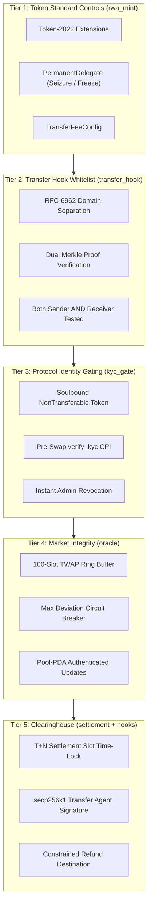
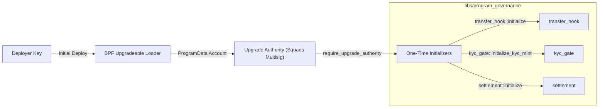

# Risk Management and Compliance Framework — Solana RWA DEX

An institutional framework detailing the risk taxonomy, multi-tiered compliance controls, execution safeguards, and governance architecture implemented across the Solana RWA DEX.

---

## Table of Contents

- [1. Executive Overview](#1-executive-overview)
- [2. Institutional RWA Risk Taxonomy](#2-institutional-rwa-risk-taxonomy)
- [3. Multi-Tiered Defense-in-Depth Architecture](#3-multi-tiered-defense-in-depth-architecture)
- [4. Detailed Control Mechanisms](#4-detailed-control-mechanisms)
  - [4.1. Tier 1: Asset-Level Controls (`rwa_mint`)](#41-tier-1-asset-level-controls-rwa_mint)
  - [4.2. Tier 2: Transfer-Level Restrictions (`transfer_hook`)](#42-tier-2-transfer-level-restrictions-transfer_hook)
  - [4.3. Tier 3: Protocol Access \& Identity Gating (`kyc_gate`)](#43-tier-3-protocol-access--identity-gating-kyc_gate)
  - [4.4. Tier 4: Market Integrity \& Price Oracles (`oracle`)](#44-tier-4-market-integrity--price-oracles-oracle)
  - [4.5. Tier 5: Settlement \& Clearing Controls (`settlement` \& `hooks`)](#45-tier-5-settlement--clearing-controls-settlement--hooks)
- [5. Execution Engine Risk Mitigation](#5-execution-engine-risk-mitigation)
  - [5.1. CLMM Controls](#51-clmm-controls)
  - [5.2. DLMM Dynamic Fee Controls](#52-dlmm-dynamic-fee-controls)
  - [5.3. Maverick Value-Neutral Bin Migration](#53-maverick-value-neutral-bin-migration)
  - [5.4. TWAMM MEV \& Front-Running Neutralization](#54-twamm-mev--front-running-neutralization)
  - [5.5. Limit Order Book Controls (`order_book`)](#55-limit-order-book-controls-order_book)
- [6. Governance, Emergency Response \& Non-Trapping Capital Guarantee](#6-governance-emergency-response--non-trapping-capital-guarantee)
- [7. Regulatory Reporting \& Audit Surveillance](#7-regulatory-reporting--audit-surveillance)

---

## 1. Executive Overview

Trading tokenized Real World Assets (RWAs) — such as US Treasury bills, private credit facilities, commercial real estate, and commodities — bridges decentralized finance with heavily regulated capital markets. Unlike generic cryptocurrency exchanges where permissionless access and instant settlement are standard, an RWA trading venue must reconcile two competing imperatives:

1. **Regulatory Compliance and Investor Protection**: Adhering to securities laws (e.g., US SEC Reg D / Reg S, European MiCA), AML/CFT regulations, sanctions screening, and legal Transfer Agent sign-off.
2. **On-Chain Security and Capital Efficiency**: Ensuring non-custodial execution, provable mathematical correctness, protection against MEV and price manipulation, and zero risk of trapped liquidity.

To meet both imperatives, this protocol implements a **Five-Tier Defense-in-Depth** architecture that embeds legal and operational safeguards directly into Solana programs and Token-2022 extensions.

---

## 2. Institutional RWA Risk Taxonomy

```
┌────────────────────────────────────────────────────────────────────────┐
│                        RWA DEX RISK TAXONOMY                          │
├───────────────────┬───────────────────┬────────────────────────────────┤
│ Regulatory & Legal│ Settlement & Cpty │ Market & Valuation             │
│ • Accreditation   │ • T+N Cleared DvP │ • TWAP Divergence              │
│ • Sanctions / AML │ • TA Signature    │ • Illiquidity Slippage         │
│ • Transfer Limits │ • Escrow Refund   │ • Toxic / Informed Flow        │
├───────────────────┼───────────────────┼────────────────────────────────┤
│ Protocol & Engine │ Smart Contract    │ Custody & Asset Integrity      │
│ • MEV / Sandwich  │ • SBF Heap OOM    │ • Off-Chain Backing Proofs     │
│ • Bin Dilution    │ • Math Overflow   │ • Metadata / ISIN Binding      │
│ • Tick Skipping   │ • Auth Bricking   │ • Seizure / Freeze Capacity    │
└───────────────────┴───────────────────┴────────────────────────────────┘
```

### 2.1. Regulatory and Compliance Risks
- **Ineligible Counterparties**: Non-accredited or sanctioned wallets attempting to purchase securities.
- **Secondary Market Leakage**: An accredited investor transferring tokens OTC to an unverified third party.
- **Regulatory Order Compliance**: Inability to execute a lawful freeze or court-ordered asset seizure.

### 2.2. Settlement and Counterparty Risks
- **Free-Riding and Instant Finality Mismatch**: Delivering assets before legal compliance clearance is completed off-chain.
- **Fund Redirection / Misrouting**: Malicious redirect of escrowed funds during cancellation or clearing.

### 2.3. Market and Valuation Risks
- **Oracle Manipulation & Flash Crashes**: Malicious traders using flash loans to skew spot prices and trigger unfair liquidations or arbitrage.
- **Stale Price Execution**: Trading against outdated NAV estimates for illiquid assets.

### 2.4. Protocol Execution & MEV Risks
- **Front-Running and Sandwich Attacks**: Block orders being front-run by predatory searchers.
- **LVR (Loss-Versus-Rebalancing) and Toxic Flow**: Passive liquidity providers being picked off during sharp market shifts.

---

## 3. Multi-Tiered Defense-in-Depth Architecture



---

## 4. Detailed Control Mechanisms

### 4.1. Tier 1: Asset-Level Controls (`rwa_mint`)

All RWA instruments are issued as **SPL Token-2022** mints featuring native extensions configured at creation:

1. **Permanent Delegate Authority**:
   - `PermanentDelegate` is assigned to a regulated institutional multisig or compliance authority.
   - Enables regulatory compliance: under court order or criminal investigation, tokens can be frozen or seized from compromised addresses without requiring the holder's private key.
2. **Transfer Fee Config (`TransferFeeConfig`)**:
   - Allows embedded protocol, tax, or regulatory withholding fees (basis points with maximum caps).
   - Withheld fees accrue inside token accounts and can be withdrawn exclusively by the configured fee authority.
3. **Metadata Pointer & Token Metadata**:
   - Links the mint directly to immutable on-chain metadata containing the asset's ISIN, CUSIP, legal prospectus URI, and NAV auditing methodology.

### 4.2. Tier 2: Transfer-Level Restrictions (`transfer_hook`)

A primary regulatory mandate for tokenized RWAs is restricting secondary transfers to whitelisted parties.

- **Dual-Proof Enforcement**: Standard whitelists verify only the destination address. The `transfer_hook` enforces that **both** source and destination accounts belong to verified institutions, folding each side's path against the published root:
  ```rust
  // Both parties must prove membership against the same root. The proofs arrive
  // as the two WhitelistEntry PDAs Token-2022 resolves from the token accounts'
  // owners - it builds the hook's data itself, so they cannot be arguments.
  require!(root_from_entry(&source_owner, source_entry) == config.merkle_root, SourceNotWhitelisted);
  require!(root_from_entry(&dest_owner, dest_entry) == config.merkle_root, DestinationNotWhitelisted);
  ```
  *Risk Mitigated*: If an institution is delisted or sanctioned, a destination-only check would allow them to liquidate their holdings into the market. Dual-proof checking blocks all outflows from delisted addresses.
- **Cryptographic Domain Separation (RFC-6962)**:
  - Leaf hash: $H(\text{0x00} \parallel \text{pubkey})$.
  - Node hash: $H(\text{0x01} \parallel \min(A, B) \parallel \max(A, B))$.
  - Sorted pairs eliminate position ambiguity and prevent second-preimage collision attacks.
- **One commitment, per-institution paths**: the whitelist is a single 32-byte root in the hook config, so a rotation is one write and the hook never iterates a list. Because Token-2022 gives the hook no way to receive a proof as instruction data, each institution's path is stored in its own `WhitelistEntry` PDA (~0.0048 SOL of rent, refunded when the institution is closed out) — the proof is *read*, not believed, so a path that no longer folds to the live root is refused when it is written and stops verifying when the root rotates.

### 4.3. Tier 3: Protocol Access & Identity Gating (`kyc_gate`)

To interact with DEX trading pools, traders must hold an active institutional KYC attestation.

- **Soulbound Credential**: The KYC token mint carries the `NonTransferable` extension. The token program refuses any `transfer` instruction, making credentials strictly bound to the KYC-approved wallet.
- **Atomic Pre-Trade Gate**: All AMM swap instructions, TWAMM order submissions, and `order_book` order creation and fills perform a CPI to `kyc_gate::verify_kyc`:
  ```rust
  // Asserts trader holds >= 1 soulbound token of the configured KYC mint
  require!(kyc_account.amount >= 1, ErrorCode::NotKycApproved);
  ```
- **Instant Non-Consensual Revocation**: When an institution's annual review fails or sanctions are triggered, the authority executes `revoke_kyc`. The `KycConfig` PDA acts as the mint's permanent delegate and burns the soulbound token immediately, locking the user out of trading within the same transaction.

### 4.4. Tier 4: Market Integrity & Price Oracles (`oracle`)

Price manipulation and flash loans present existential threats to AMM liquidity.

- **100-Observation Geometric Ring Buffer**: Tracks historical $(\text{timestamp}, \sqrt{P}_{x64}, \text{cumulative})$.
- **Interpolated TWAP Computation**: For window $\Delta t$, the accumulator is interpolated between stored boundary observations and extrapolated to current timestamp $t_{\text{now}}$, ensuring accurate time-weighted valuations regardless of swap frequency.
- **Pre-Swap Deviation Guard**: Swaps test the spot price against the TWAP:
  ```rust
  let diff = if spot > twap { spot - twap } else { twap - spot };
  let deviation_bps = (diff * 10_000) / twap;
  require!(deviation_bps <= max_deviation_bps, ErrorCode::PriceDeviationExceeded);
  ```
- **Emergency Automatic Latch (`trip_breaker`)**: If extreme deviation occurs, the pool PDA calls `trip_breaker`, locking `is_paused = true`. Only the authorized oracle owner can review the condition and invoke `unpause_pool`.

### 4.5. Tier 5: Settlement & Clearing Controls (`settlement` & `hooks`)

In institutional markets, physical delivery of securities is decoupled from electronic trade matching.

- **T+N Settlement Window**: Post-swap proceeds are routed into an isolated per-trade escrow token account (`[b"escrow", trade_id.to_le_bytes()]`) owned by the program's `[b"escrow_authority"]` PDA. The `SettlementVault` locks tokens until:
  $$\text{Clock::slot} \ge \text{settlement\_slot}$$
- **Transfer Agent Off-Chain Clearance**: Final payout requires a valid secp256k1 signature from the institutional Transfer Agent over a tamper-proof 104-byte preimage:
  $$\text{Preimage} = \text{trade\_id} \ (8) \parallel \text{taker} \ (32) \parallel \text{mint} \ (32) \parallel \text{amount} \ (8)$$
  $$\text{Message} = \text{keccak256}(\text{Preimage})$$
  Recovered public key $Q$ must equal the resolved transfer agent key (either the per-mint agent override PDA `[b"agent", mint]` if configured, or global `config.transfer_agent_secp256k1`).
- **Signature Malleability Guard (Low-s Enforcement)**: The program enforces canonical secp256k1 low-s signatures ($s \le N/2$), rejecting malleable signatures with `HighSignatureS`.
- **Cancellation Destination Binding (H-1 Remediation)**: If compliance rejects the trade, `cancel_settlement` can be triggered by authority. Funds are strictly constrained to return to the original `refund_source` token account:
  ```rust
  require_keys_eq!(
      refund_token_account.key(),
      settlement_vault.refund_source,
      ErrorCode::InvalidRefundAccount
  );
  ```
  This eliminates attacks where a compromised authority or malicious pool CPI redirects pending escrows to an arbitrary wallet.
- **Unresponsive Agent Protection (`refund_expired`)**: If the transfer agent becomes unresponsive and neither settles nor cancels the trade within `EXPIRY_WINDOW_SLOTS` (216,000 slots ~ 24 hours) past `settlement_slot`, anyone can invoke `refund_expired` to return the escrowed funds to `refund_source`.
- **Rent Reclamation (`close_settlement`)**: Once a settlement reaches a terminal state (`Settled`, `Cancelled`, or `Expired`), the config authority can close the escrow token account and vault PDA via `close_settlement`, reclaiming rent to `rent_receiver`.

---

## 5. Execution Engine Risk Mitigation

```
┌────────────────────────────────────────────────────────────────────────┐
│                        AMM RISK MITIGATION MATRIX                      │
├─────────────┬──────────────────────────────────────────────────────────┤
│ Engine      │ Risk Controls & Invariants                               │
├─────────────┼──────────────────────────────────────────────────────────┤
│ CLMM        │ • Bitmap-verified tick sequence (no tick skipping)       │
│             │ • Partial fills on boundary (never reverts on depth)     │
│             │ • Asymmetric rounding in pool's favour                   │
│             │ • Admin pause with non-trapping exit                     │
├─────────────┼──────────────────────────────────────────────────────────┤
│ DLMM        │ • Zero-slippage intra-bin execution (anti-sandwich)      │
│             │ • Dynamic fee multiplier (50% -> 90% utilization)        │
│             │ • Decimal scaling (10^(dec_a - dec_b)) prevents skew     │
│             │ • Euclidean indexing prevents negative-index overlap     │
├─────────────┼──────────────────────────────────────────────────────────┤
│ Maverick    │ • Value-neutral bin merges (LP value held constant)      │
│             │ • Static baseline requirement (prevents unanchored moves)│
│             │ • Fixed 70-byte MoveState stride (prevents SBF heap OOM) │
│             │ • Move-chain withdrawal tracing                          │
├─────────────┼──────────────────────────────────────────────────────────┤
│ TWAMM       │ • Virtual order netting at marginal price (0 fee / slippage)│
│             │ • Time discretization eliminates MEV sandwich attacks    │
│             │ • Q64.64 accumulator-based per-unit accounting           │
│             │ • Expiry-sorted singly linked list (no skipped orders)   │
└─────────────┴──────────────────────────────────────────────────────────┘
```

### 5.1. CLMM Controls
- **Tick Bitmap Integrity**: Solves the "tick-skipping" exploit. Attackers might attempt to pass non-consecutive tick accounts to avoid updating active liquidity $L$. The program matches supplied accounts against bits in the pool's tick bitmap.
- **Asymmetric Rounding**: Liquidity additions round up token requirements ($A_{\text{req}}, B_{\text{req}}$); withdrawals and swap payouts round down. The pool can never pay out more than mathematical bounds dictate.

### 5.2. DLMM Dynamic Fee Controls
- **Dynamic Fee Multiplier**: Protects LPs against toxic order flow:
  $$\text{Fee} = \text{base\_fee} \times \left(1 + \frac{\text{utilization}}{100}\right)$$
  When a bin becomes one-sided ($90\%$ utilization), fees increase by up to $90\%$, extracting maximum surplus from informed traders and compensating LPs.
- **Euclidean Bin Math**: Using Euclidean division ($\lfloor \text{bin\_id} / 70 \rfloor_{\text{Euclidean}}$) guarantees that negative tick IDs correctly map into negative `BinArray` accounts without overlapping or misallocating bins.

### 5.3. Maverick Value-Neutral Bin Migration
- **Zero Dilution Guarantee**: When bins are relocated toward active price, the destination shares minted strictly preserve value:
  $$\text{minted} = \text{moved\_value} \times \frac{\text{dest\_supply}}{\text{dest\_value}}$$
  Existing LPs suffer zero dilution, and moved LPs retain exactly the value they contributed.
- **Fixed-Stride Memory Architecture**: Mitigates SBF heap exhaustion. Serialized bins maintain a fixed 70-byte stride (`MoveState`), allowing in-place byte manipulation without loading multi-kilobyte vectors into Solana's 32 KiB bump heap.

### 5.4. TWAMM MEV & Front-Running Neutralization
- **Virtual Order Netting**: In institutional markets, large orders attract sandwich bots that drain value. TWAMM nets opposing orders during each epoch:
  - If Order 1 sells 1,000,000 token A and Order 2 buys 1,000,000 token A, the flows match directly at the marginal price.
  - **Zero Price Impact & Zero AMM Fees**: The trade never interacts with the AMM curve, completely neutralizing front-running and MEV extraction.

### 5.5. Limit Order Book Controls (`order_book`)

- **Per-order escrow isolation.** Every order's funds sit in the order PDA's own ATA for the side's mint, never a shared vault, so a failure or exploit in one order cannot reach another maker's balance. `remaining_amount` is the order's claim on that escrow.
- **Gated entry, ungated exit.** When the book has a `kyc_config`, `create_order` verifies the maker and `fill_order` verifies the taker. `cancel_order` deliberately bypasses KYC, pause and expiry: an exit is never conditioned on compliance state.
- **Maker-favourable rounding plus a taker bound.** The counter-leg rounds quote up for an ask and base down for a bid, and a fill that rounds either leg to zero reverts. The taker additionally signs off on `max_counter_amount`, so a stale or manipulated price cannot overcharge it.
- **No oracle on the book.** Unlike the AMMs there is no TWAP/deviation gate; the maker sets the price and the taker's slippage bound is the only execution control. A book should therefore only be opened for pairs whose price the venue is prepared to govern by maker discipline, not by an oracle.
- **Delivery is atomic in value.** The taker's payment leg is transferred before the escrowed leg is released, and the order's remaining/filled state is written and exited before any CPI or token transfer, so a transfer-hook callback cannot re-enter against a stale balance.
- **Non-trapping exit with a sweep.** `cancel_order` refunds the escrow's whole balance, not just `remaining_amount`. Because the escrow address is publicly derivable and the token program refuses to close a non-empty account, refunding only the recorded amount would let a one-unit donation permanently trap a maker's unfilled funds.
- **Settlement-id hygiene.** A settlement-routed fill names its own `trade_id`; a duplicate fails closed in the settlement vault's `init`, so a collision cannot overwrite or redirect another trade's escrow. Proceeds are recorded against the **maker**, binding the Transfer Agent's release to the party that placed the order.

---

## 6. Governance, Emergency Response & Non-Trapping Capital Guarantee

### 6.1. The Non-Trapping Capital Invariant

A recurring vulnerability in DeFi protocols is the "admin freeze trap": when an administrator pauses a contract to mitigate an exploit, honest user capital is locked indefinitely.

> [!IMPORTANT]
> **Non-Trapping Capital Invariant**:
> In all four AMMs, the order book and settlement contracts, the `is_paused` flag halts **new exposure only** (swaps, deposits, order creation, fills).
> The following exit instructions are **permanently unpausable**:
> - `clmm::remove_liquidity` and `clmm::collect_fees`
> - `dlmm::remove_liquidity`
> - `maverick::remove_liquidity`
> - `twamm::withdraw_proceeds` and `twamm::cancel_order`
> - `order_book::cancel_order`
> - `settlement::cancel_settlement`
> - `settlement::refund_expired` (permissionless recovery after expiry window)
> 
> Under no circumstances can governance or emergency pause mechanisms trap LP capital or user funds.

### 6.2. Privilege Architecture & Governance



1. **One-Time Initialization Guard (`libs/program_governance`)**:
   - `require_upgrade_authority` inspects the BPF loader's `ProgramData` account.
   - Prevents unauthorized front-running of singleton configurations.
2. **Defensive Authority Rotation**:
   - All `set_authority` instructions validate:
     ```rust
     require_keys_neq!(new_authority, Pubkey::default(), ErrorCode::InvalidAuthority);
     ```
     Prevents accidental rotation to `11111111111111111111111111111111`, which would permanently brick pool administration.
3. **Multisig Governance Recommendation**:
   - All program upgrade authorities and pool admin roles should be held by a **Squads multisig** with at least a 3-of-5 threshold of distributed institutional keys.
   - Transfer Agent keys must be secured in institutional Hardware Security Modules (HSM) or cloud KMS.

---

## 7. Regulatory Reporting & Audit Surveillance

To support compliance audits and market surveillance:

1. **On-Chain Audit Trail**:
   - Every state transition emits structured runtime messages via Solana `msg!` logs (recording settlement transitions, KYC verifications, price observations, and execution lifecycle). Strongly-typed Anchor events (`RecordObservation`, `InitiateSettlement`, `SettleTrade`, `BinMoved`, etc.) are tracked under proposed feature P5 for zero-copy off-chain CPI parsing.
2. **Off-Chain Indexer Surveillance (`services/indexer`)**:
   - Ingests on-chain logs in real time, validating that every settlement signature maps to an approved Transfer Agent compliance ticket.
   - Generates trade audit reports including trade ID, taker pubkey, timestamp, slippage, and Transfer Agent signature hash.
3. **Automated Sanctions Screening**:
   - Keeper daemons cross-reference newly added whitelist entries and KYC holders against international sanctions databases (OFAC, EU, UN).
   - If a match is detected, the authority invokes `transfer_hook::update_root` and `kyc_gate::revoke_kyc` to immediately isolate the wallet.
