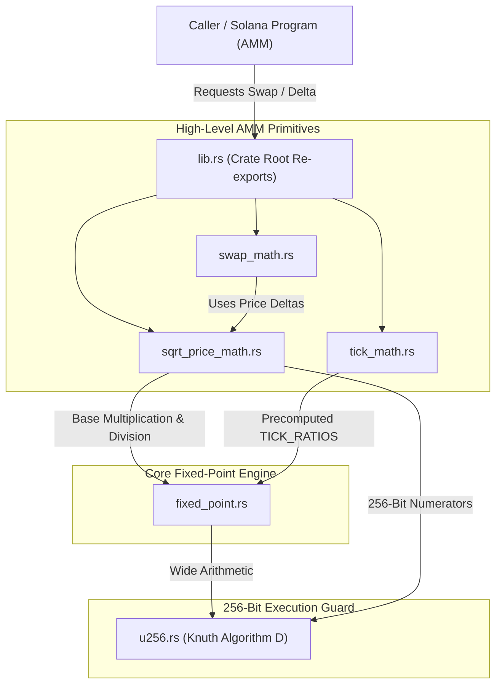

# Q64.64 Fixed-Point Math Core (`math_core`)

`math_core` is a zero-dependency, `#![no_std]` Rust library providing high-precision Q64.64 fixed-point arithmetic and Concentrated Liquidity Automated Market Maker (CLMM) math primitives for Solana programs.

---

## Table of Contents

- [Q64.64 Fixed-Point Math Core (`math_core`)](#q6464-fixed-point-math-core-math_core)
  - [Table of Contents](#table-of-contents)
  - [Overview \& Architecture](#overview--architecture)
  - [Format \& Scaling Specifications](#format--scaling-specifications)
  - [Source Files Deep-Dive](#source-files-deep-dive)
    - [1. `lib.rs`: Crate Root \& Error Handling](#1-librs-crate-root--error-handling)
      - [Key Types \& Constants](#key-types--constants)
    - [2. `fixed_point.rs`: Q64.64 Core Fixed-Point Engine](#2-fixed_pointrs-q6464-core-fixed-point-engine)
      - [Key Functions](#key-functions)
    - [3. `tick_math.rs`: Logarithmic Tick \& Price Conversions](#3-tick_mathrs-logarithmic-tick--price-conversions)
      - [Mathematical Foundation](#mathematical-foundation)
      - [Key Functions \& Constants](#key-functions--constants)
    - [4. `sqrt_price_math.rs`: Liquidity Deltas \& Price Movement](#4-sqrt_price_mathrs-liquidity-deltas--price-movement)
      - [Mathematical Formulas](#mathematical-formulas)
      - [Key Functions](#key-functions-1)
    - [5. `swap_math.rs`: Swap Step Execution Engine](#5-swap_mathrs-swap-step-execution-engine)
      - [Key Structs \& Functions](#key-structs--functions)
    - [6. `u256.rs`: 256-Bit Arithmetic Engine (Knuth Algorithm D)](#6-u256rs-256-bit-arithmetic-engine-knuth-algorithm-d)
      - [Features](#features)
  - [Component Interconnection \& Data Flow](#component-interconnection--data-flow)
  - [Combined End-to-End Workflows \& Code Examples](#combined-end-to-end-workflows--code-examples)
    - [Scenario 1: Provisioning Concentrated Liquidity](#scenario-1-provisioning-concentrated-liquidity)
    - [Scenario 2: Executing an Exact Input Swap Step](#scenario-2-executing-an-exact-input-swap-step)
  - [AMM Safety \& Asymmetric Rounding Rules](#amm-safety--asymmetric-rounding-rules)
  - [Consumers](#consumers)
  - [Testing \& Verification](#testing--verification)
    - [Limits](#limits)

---

## Overview & Architecture

Uniswap v3 and Raydium CLMM rely heavily on fixed-point arithmetic to manage continuous price curves, concentrated liquidity ticks, and sub-penny swap calculations.

Uniswap v3 uses Q64.96 (160 bits total), requiring a 256-bit integer representation (`uint256`) natively supported by the EVM. However, Solana's eBPF architecture natively operates on **128-bit registers (`u128`)**. `math_core` uses **Q64.64** format (64 bits for the integer part, 64 bits for the fractional part), fitting the entire number into a single native `u128` register while preserving 64 bits (~19 decimal places) of fractional accuracy.

---

## Format & Scaling Specifications

$$\text{Encoded Value} = \text{Real Value} \times 2^{64}$$

- **`Q64` Constant**: $1.0$ is represented as $2^{64} = 18,446,744,073,709,551,616$.
- **$\sqrt{P}$ Representation**: Prices are stored as $\sqrt{\text{Price}} \times 2^{64}$.
- **Tick Index Range**: $t \in [-443\,636, 443\,636]$, corresponding to prices from $4.295 \times 10^{-10}$ up to $7.922 \times 10^{28}$.

---

## Source Files Deep-Dive

### 1. `lib.rs`: Crate Root & Error Handling

- **Location**: [`src/lib.rs`](src/lib.rs)
- **Role**: Configures `#![no_std]`, defines the module tree, exposes the unified `MathError` enum, and re-exports all key functions at crate root.

#### Key Types & Constants

- `pub enum MathError`:
  - `Overflow`: Arithmetic overflow or value exceeding upper bit limits.
  - `DivByZero`: Division by zero.
  - `TickOutOfBounds`: Tick index outside $[-443\,636, 443\,636]$.
  - `SqrtPriceOutOfBounds`: Price outside $[\text{MIN\_SQRT\_PRICE}, \text{MAX\_SQRT\_PRICE}]$.
  - `InvalidFee`: Swap fee equal to or exceeding 1,000,000 pips (100%).
- `pub type MathResult<T> = Result<T, MathError>`
- `pub const fn from_u64(x: u64) -> u128`: Shifts an integer by 64 bits into Q64.64 format.
- `pub const fn to_u64(x: u128) -> u64`: Truncates fractional bits, returning the integer part as `u64`.

---

### 2. `fixed_point.rs`: Q64.64 Core Fixed-Point Engine

- **Location**: [`src/fixed_point.rs`](src/fixed_point.rs)
- **Role**: Implements fundamental Q64.64 math operations with explicit rounding direction and full 256-bit intermediate scaling.

#### Key Functions

- `pub fn mul_shr(a: u128, b: u128) -> MathResult<u128>`: Multiplies two Q64.64 values, rounding down: $\lfloor (a \times b) / 2^{64} \rfloor$.
- `pub fn mul_ceil(a: u128, b: u128) -> MathResult<u128>`: Multiplies two Q64.64 values, rounding up: $\lceil (a \times b) / 2^{64} \rceil$.
- `pub fn div_shr(a: u128, b: u128) -> MathResult<u128>`: Divides two Q64.64 values ($a / b$), rounding down: $\lfloor (a \times 2^{64}) / b \rfloor$.
- `pub fn div_ceil(a: u128, b: u128) -> MathResult<u128>`: Divides two Q64.64 values ($a / b$), rounding up: $\lceil (a \times 2^{64}) / b \rceil$.
- `pub fn sqrt(x: u128) -> MathResult<u128>`: Computes integer square root $\lfloor \sqrt{x} \rfloor$ safely up to `u128::MAX` without overflowing.
- `pub fn isqrt_wide(hi: u128, lo: u128) -> MathResult<u128>`: Takes integer square root of a 256-bit number ($hi \times 2^{128} + lo$).
- `pub fn sqrt_price(price: u128) -> MathResult<u128>`: Computes square root of a Q64.64 price in Q64.64: $\lfloor \sqrt{\text{price} \times 2^{64}} \rfloor$.
- `pub fn price_from_sqrt_price(sqrt_price: u128) -> MathResult<u128>`: Converts $\sqrt{P}$ back to price $P$: $\lfloor \text{sqrt\_price}^2 / 2^{64} \rfloor$.

---

### 3. `tick_math.rs`: Logarithmic Tick & Price Conversions

- **Location**: [`src/tick_math.rs`](src/tick_math.rs)
- **Role**: Converts tick indices $t \in [-443\,636, 443\,636]$ to $\sqrt{\text{price}} = 1.0001^{t/2}$ and vice versa in $O(1)$ time.

#### Mathematical Foundation

Instead of executing $O(N)$ multiplication loops, `tick_math` decomposes the binary magnitude of tick $t$:
$$1.0001^{t/2} = \prod_{i=0}^{18} \left( 1.0001^{2^i / 2} \right)^{b_i}$$

It uses 19 precomputed Q64.64 constants (`TICK_RATIOS`), requiring at most 19 bitwise multiplication steps.

#### Key Functions & Constants

- `pub const MAX_TICK: i32 = 443_636` & `pub const MIN_TICK: i32 = -443_636`
- `pub const MIN_SQRT_PRICE: u128 = 4_295_048_017`
- `pub const MAX_SQRT_PRICE: u128 = 79_226_673_515_401_279_963_822_778_343`
- `pub fn sqrt_price_at_tick(tick: i32) -> MathResult<u128>`: $O(1)$ conversion from tick index $t$ to $\sqrt{P}$.
- `pub fn tick_at_sqrt_price(sqrt_price: u128) -> MathResult<i32>`: Binary search inverse mapping $\sqrt{P}$ back to the tick index $t$.

---

### 4. `sqrt_price_math.rs`: Liquidity Deltas & Price Movement

- **Location**: [`src/sqrt_price_math.rs`](src/sqrt_price_math.rs)
- **Role**: Computes token amounts ($\Delta a_0, \Delta a_1$) held in liquidity positions and target prices after single token inputs.

#### Mathematical Formulas

For liquidity $L$ bounded between $[\sqrt{P_a}, \sqrt{P_b}]$:
$$\Delta a_0 = L \times \left( \frac{1}{\sqrt{P_a}} - \frac{1}{\sqrt{P_b}} \right) = \frac{L \times 2^{64} \times (\sqrt{P_b} - \sqrt{P_a})}{\sqrt{P_a} \times \sqrt{P_b}}$$
$$\Delta a_1 = L \times (\sqrt{P_b} - \sqrt{P_a}) / 2^{64}$$

#### Key Functions

- `pub fn get_amount_0_delta(sqrt_a: u128, sqrt_b: u128, liquidity: u128, round_up: bool) -> MathResult<u128>`
- `pub fn get_amount_1_delta(sqrt_a: u128, sqrt_b: u128, liquidity: u128, round_up: bool) -> MathResult<u128>`
- `pub fn get_next_sqrt_price_from_amount_0(amount: u128, sqrt_p: u128, liquidity: u128, add: bool) -> MathResult<u128>`
- `pub fn get_next_sqrt_price_from_amount_1(amount: u128, sqrt_p: u128, liquidity: u128, add: bool) -> MathResult<u128>`
- `pub fn get_amount_0_for_amount_1(amount_1: u128, sqrt_p: u128) -> MathResult<u128>`: Spot ratio conversion.
- `pub fn get_amount_1_for_amount_0(amount_0: u128, sqrt_p: u128) -> MathResult<u128>`: Spot ratio conversion.

---

### 5. `swap_math.rs`: Swap Step Execution Engine

- **Location**: [`src/swap_math.rs`](src/swap_math.rs)
- **Role**: Core state machine step for executing swaps across a liquidity range.

#### Key Structs & Functions

- `pub const FEE_DENOMINATOR: u32 = 1_000_000` (Fee in pips, e.g., 3,000 pips = 0.30%).
- `pub struct SwapStepResult`:
  - `sqrt_price_next`: New $\sqrt{P}$ after consuming input or reaching target tick.
  - `amount_in`: Raw input token consumed (excluding fee).
  - `amount_out`: Raw output token produced.
  - `fee_amount`: Fee collected in input tokens.
- `pub fn compute_swap_step(sqrt_price_current: u128, sqrt_price_target: u128, liquidity: u128, amount_remaining: u128, fee_pips: u32, exact_in: bool) -> MathResult<SwapStepResult>`

---

### 6. `u256.rs`: 256-Bit Arithmetic Engine (Knuth Algorithm D)

- **Location**: [`src/u256.rs`](src/u256.rs)
- **Role**: Custom 256-bit unsigned integer (`U256`) stored as 4 little-endian 64-bit limbs `[u64; 4]`.

#### Features

- **Knuth Algorithm D**: Division of arbitrary 256-bit numbers by 256-bit divisors without dynamic memory.
- `pub(crate) fn mul_u128(a: u128, b: u128) -> U256`: Computes exact 256-bit product of two 128-bit numbers.
- `pub(crate) fn mul_div_floor(a: u128, b: u128, c: u128) -> MathResult<u128>`: Computes $\lfloor (a \times b) / c \rfloor$ with a 256-bit numerator.
- `pub(crate) fn mul_div_ceil(a: u128, b: u128, c: u128) -> MathResult<u128>`: Computes $\lceil (a \times b) / c \rceil$ with a 256-bit numerator.
- `pub(crate) fn div_shifted(num: U256, shift: u32, den: U256, round_up: bool) -> MathResult<u128>`: Computes $(num \times 2^{shift}) / den$.

---

## Component Interconnection & Data Flow



---

## Combined End-to-End Workflows & Code Examples

### Scenario 1: Provisioning Concentrated Liquidity

Calculating exact required token inputs ($\Delta a_0$ and $\Delta a_1$) to open a position between tick $[-1000, 1000]$:

```rust
use math_core::{
    get_amount_0_delta, get_amount_1_delta, sqrt_price_at_tick,
};

fn calculate_liquidity_deposit() {
    // 1. Convert tick boundaries to Q64.64 sqrt prices
    let sqrt_price_a = sqrt_price_at_tick(-1000).unwrap();
    let sqrt_price_b = sqrt_price_at_tick(1000).unwrap();
    let liquidity = 5_000_000_000u128; // Desired liquidity L

    // 2. Compute token deltas (rounding up so the pool is always fully collateralized)
    let token_0_required = get_amount_0_delta(sqrt_price_a, sqrt_price_b, liquidity, true).unwrap();
    let token_1_required = get_amount_1_delta(sqrt_price_a, sqrt_price_b, liquidity, true).unwrap();

    println!("Token 0 deposit required: {}", token_0_required);
    println!("Token 1 deposit required: {}", token_1_required);
}
```

### Scenario 2: Executing an Exact Input Swap Step

Simulating a swap step selling 1,000,000 units of Token 0 with a 0.3% fee (3,000 pips):

```rust
use math_core::{compute_swap_step, sqrt_price_at_tick};

fn execute_swap_step() {
    let current_price = sqrt_price_at_tick(0).unwrap();
    let target_price = sqrt_price_at_tick(100).unwrap(); // Target next tick boundary
    let liquidity = 10_000_000_000u128;
    let amount_remaining = 1_000_000u128;
    let fee_pips = 3_000; // 0.30%

    let step = compute_swap_step(
        current_price,
        target_price,
        liquidity,
        amount_remaining,
        fee_pips,
        true, // exact_in
    ).unwrap();

    println!("Next Sqrt Price: {}", step.sqrt_price_next);
    println!("Token 0 Consumed: {}", step.amount_in);
    println!("Token 1 Output: {}", step.amount_out);
    println!("Fee Collected: {}", step.fee_amount);
}
```

---

## AMM Safety & Asymmetric Rounding Rules

To protect liquidity providers against rounding-based exploit vectors, `math_core` strictly enforces asymmetric rounding across all operations:

1. **Tokens Paid TO Pool (Deposits / Swaps In)**: Always rounded **UP** ($\lceil \cdot \rceil$).
2. **Tokens Paid OUT of Pool (Withdrawals / Swaps Out)**: Always rounded **DOWN** ($\lfloor \cdot \rfloor$).
3. **Trading Fees Collected**: Always rounded **UP** ($\lceil \cdot \rceil$).

---

## Consumers

| Program | What it uses |
| :--- | :--- |
| `clmm` | Tick/sqrt-price conversions, liquidity deltas, `swap_step`, `u256` multiply/divide |
| `dlmm` | Same fixed-point primitives for bin math and swap steps |
| `maverick` | Fixed-point primitives, sqrt-price and swap-step math |
| `twamm` | Swap-step math for the embedded AMM the schedule executes against |

The crate is a **library, not a program**: it has no entrypoint, no state, no
accounts and no dependency on Anchor. It is `#![no_std]` and dependency-free so
it can be audited and unit-tested without a Solana toolchain (`["dependencies"]`
in its `Cargo.toml` is deliberately empty).

---

## Testing & Verification

The crate carries 53 inline unit tests, all pure and toolchain-free:

| File | Tests | Covers |
| :--- | :--- | :--- |
| `sqrt_price_math.rs` | 15 | Amount deltas for single-tick and multi-tick ranges, rounding direction, liquidity scaling, degenerate/zero-width ranges, price moves, spot conversions |
| `tick_math.rs` | 11 | Bounds and endpoint constants, `tick 0 == 1`, monotonicity, **round-trip exactness on every tick**, lower-tick resolution between ticks, negative-tick reciprocal rounding |
| `swap_math.rs` | 10 | Fee validation and rounding, no-op steps, reaching vs. stopping short of the target, exact-out limits, direction, multi-step sequences consuming the input |
| `fixed_point.rs` | 9 | `mul`/`mul_div` rounding directions, division by zero, `sqrt` across the range, sqrt-price definition and its inverse, encoded helpers, overflow |
| `u256.rs` | 8 | Knuth division against a reference, exact `mul_u128`, `mul_div`, `mul_shr` rounding, shifted division, overflow and shift/ordering |

```bash
cargo test -p math_core          # just this crate
cargo test --workspace           # with the four AMMs that consume it
```

What the tests pin down, beyond individual formulas:

* **Rounding never favours the trader.** Every path that pays tokens *out* of a
  pool rounds down and every path that takes tokens *in* (or fees) rounds up;
  a change that flips a direction shows up as a failing delta test.
* **Overflow is an error, not a wrap.** All intermediate `u256` results are
  checked; a swap that cannot be represented returns `MathError` rather than a
  silently truncated price.
* **Zero and boundary prices are rejected.** `sqrt_price = 0`, `liquidity = 0`
  and out-of-range ticks are handled explicitly instead of producing a division
  by zero downstream.
* **Every tick round-trips.** One case walks the full tick range and asserts
  `tick → sqrt_price → tick` is exact, which catches a one-unit constant change
  that sample-based tests miss.
* **Reference constants.** The tick endpoints match the declared constants, so an
  accidental change to a boundary fails loudly.

### Limits

* **No property/fuzz tests.** Coverage is example-based; a proptest harness over
  `mul_div` and `swap_step` would raise confidence in the arithmetic bounds.
* **No `u512`.** Intermediate products are `u256`, which is enough for the
  supported tick range but means a wider intermediate would be a real change,
  not a flag.
* **No floating point anywhere**, by design: what looks like a rounding bug is
  usually a caller passing an un-scaled value — see the scaling table above.
