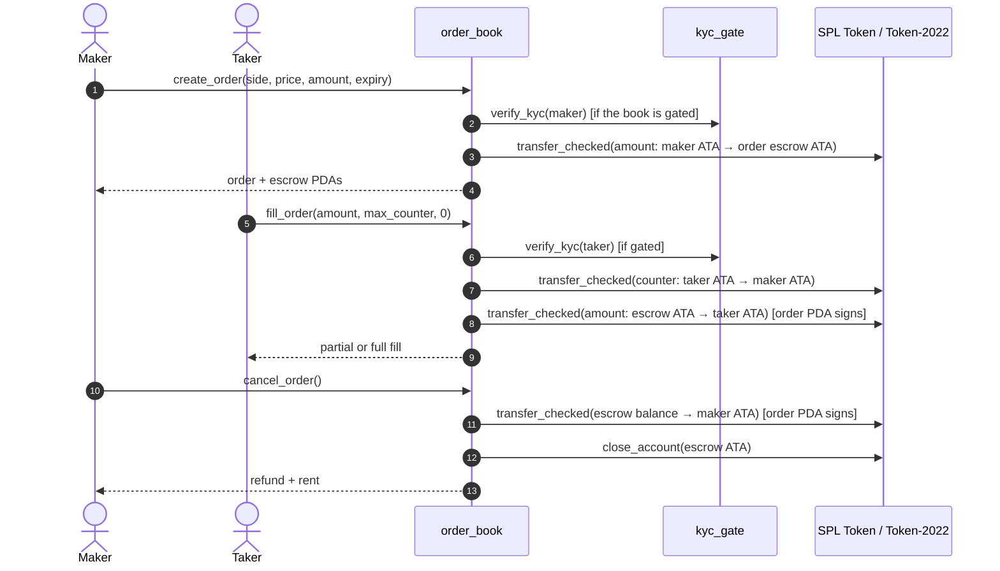

# Limit Order Book

A resting limit-order program for the RWA DEX. Makers escrow one side of a
trade, state a price and an expiry, and any counterparty can fill the order in
full or in pieces until it expires. Proceeds can be routed through the existing
`hooks` → `settlement` T+N rail, so an order book fill clears exactly like an
AMM swap.

Program ID: `3ACX2Lc67uZW65PA3QbYRLttmxE766eSDyD9Sd2yggwD`

---

## 🌟 Overview

The four AMM engines can only trade against a pool. An order book adds the
primitive desks actually use: a maker's price rests on-chain until someone
takes it. The program deliberately reuses the rails already in the repository
instead of inventing new ones:

* **Escrow** — one associated token account per order, owned by the order PDA.
  Orders never share a vault, so one maker's funds can never reach another's.
* **Compliance** — when the book has a `kyc_config`, `create_order` verifies the
  maker and `fill_order` verifies the taker through `kyc_gate::verify_kyc`.
  Cancellation is never gated.
* **Clearing** — when the book has a `hooks_authority`, a fill's proceeds are
  paid into the hooks custody ATA and locked in the T+N settlement escrow by
  `hooks::after_swap`. The vault records the **maker** as its taker, so the
  Transfer Agent's release signature binds to the party that placed the order.

### Key characteristics

* **One book per `(base, quote)` pair.** The book is a PDA keyed by the mints in
  the order they are passed; `book(A, B)` and `book(B, A)` are different markets.
* **One escrow per order.** The escrow is the order PDA's ATA for the order's
  side, so an order can only ever spend its own balance.
* **Fill-denominated-in-escrow accounting.** `fill_order(amount)` always means
  `amount` of the escrow token, which makes partial fills unambiguous; the
  counter-leg is derived and rounded in the maker's favour.
* **Optional rails, fixed at creation.** KYC and settlement routing are chosen
  when the book is created and cannot be changed afterwards.
* **Exit-first.** Pausing and expiry stop new exposure (orders and fills) but
  never cancellation, and cancellation sweeps the whole escrow back to the maker.
* **No shared vault, no matching engine.** The program escrows and settles a
  single order per instruction; it does not run a matching engine, maintain a
  price-time queue, or route across orders.

---

## 📐 Price & amount model

### Price scale

`price` is **quote raw units per one base raw unit, scaled by `PRICE_SCALE =
1_000_000_000`** (`1e9`). A price of `2_000_000_000` means one raw base unit
costs two raw quote units, independent of either mint's decimals.

The pricing math is decimal-agnostic: decimals only matter to clients converting
a human quote-per-base price into the raw price (and to the token program, which
receives each mint's decimals on the transfer):

```
raw_price = human_price × 10^(quote_decimals − base_decimals) × 1e9
```

| Base / quote decimals | Human price | Raw `price` |
| :--- | :--- | :--- |
| 6 / 6 | 2.50 quote per base | `2_500_000_000` |
| 9 / 6 | 2.50 quote per base | `2_500_000` |
| 6 / 9 | 2.50 quote per base | `2_500_000_000_000` |

The frontend implements both directions in `OrdersPage` (`toRawPrice`,
`fromRawPrice`); everything else on chain works in raw units.

### Sides

| Side | Escrow token | Maker wants | Taker pays | Taker receives |
| :--- | :--- | :--- | :--- | :--- |
| `Ask` | base | quote | quote | base |
| `Bid` | quote | base | base | quote |

### Fill legs and rounding

`fill_order(amount, max_counter_amount, trade_id)` denominates `amount` in the
**escrow token** — base for an ask, quote for a bid. The counter-leg is:

| Side | Base leg | Quote leg |
| :--- | :--- | :--- |
| `Ask` | `amount` | `ceil(amount × price / 1e9)` |
| `Bid` | `floor(amount × 1e9 / price)` | `amount` |

Rounding is always in the maker's favour: quote is rounded **up** for an ask and
base is rounded **down** for a bid. Both legs must be non-zero after rounding,
otherwise the fill is rejected with `ZeroFillLeg` rather than giving value away.

`max_counter_amount` is the taker's slippage bound on the counter-leg (quote for
an ask, base for a bid). A fill whose counter-leg exceeds it reverts with
`SlippageExceeded`. It is a *bound*, not a target: the program computes the leg
from the maker's price, so there is nothing for the taker to negotiate.

### Worked examples

**Ask.** A 6-decimal base token is offered at 2.50 quote per token. The maker
places 25 tokens (`25_000_000` raw base) at `price = 2_500_000_000`. A taker
fills 10 tokens (`10_000_000` raw base):

```
quote = ceil(10_000_000 × 2_500_000_000 / 1_000_000_000) = 25_000_000
```

The taker receives `10_000_000` base and pays `25_000_000` quote (25.00 quote),
and the order's `remaining_amount` drops from `25_000_000` to `15_000_000`.

**Bid.** A maker escrows 50.00 quote (`50_000_000` raw) to buy base at 2.00
quote per token (`price = 2_000_000_000`). A taker fills `20_000_000` quote:

```
base = floor(20_000_000 × 1_000_000_000 / 2_000_000_000) = 10_000_000
```

The taker pays `10_000_000` base and receives `20_000_000` quote.

**Rounding.** `fill_legs(Ask, 3, 1_500_000_000) = (3, 5)` — 4.5 quote rounds up.
`fill_legs(Bid, 5, 2_000_000_000) = (2, 5)` — 2.5 base rounds down. Both are
pinned by unit tests.

### Transfer fees

The deposit is **measured after the transfer**: `create_order` records what the
escrow actually received, so a Token-2022 transfer fee cannot leave an order
promising more base/quote than it holds. On the payment side, the rail-off path
pays the maker's ATA the nominal counter-leg and does not gross the fee up, so a
fee-bearing quote mint delivers slightly less than `filled_quote` records; the
settlement-routed path measures the custody delta before escrowing it, so the
vault records exactly what arrived.

---

## ⚙️ Program constants

| Constant | Value | Meaning |
| :--- | :--- | :--- |
| `PRICE_SCALE` | `1_000_000_000` | Quote-per-base price multiplier. |
| `BOOK_SEED` | `b"book"` | Book PDA prefix. |
| `ORDER_SEED` | `b"order"` | Order PDA prefix. |
| `Book::LEN` | `178` bytes | `8 + 32·5 + 8 + 1 + 1`. |
| `Order::LEN` | `138` bytes | `8 + 32·2 + 8 + 1 + 8·5 + 8·2 + 1`. |
| Sentinel | program ID | Marks an absent optional rail account. |

---

## 🔑 Account architecture & PDAs

### PDA seeds

| Account | Seeds | Owner |
| :--- | :--- | :--- |
| `Book` | `[b"book", base_mint, quote_mint]` | `order_book` |
| `Order` | `[b"order", book, owner, order_id.to_le_bytes()]` | `order_book` |
| Escrow token account | associated-token address of `(order PDA, escrow mint, token program)` | token program |

The escrow is an ATA rather than a raw token account, so its address is a pure
function of the order PDA and the mint — no extra seed or registry is needed.

### `Book` (178 bytes)

| Offset | Field | Type | Meaning |
| :--- | :--- | :--- | :--- |
| 0 | discriminator | `[u8; 8]` | Anchor account tag. |
| 8 | `mint_base` | `Pubkey` | Market base mint. |
| 40 | `mint_quote` | `Pubkey` | Market quote mint. |
| 72 | `authority` | `Pubkey` | Pause/rotation key (set to the creator at init). |
| 104 | `kyc_config` | `Pubkey` | KYC gate config, or `Pubkey::default` when off. |
| 136 | `hooks_authority` | `Pubkey` | Hooks authority, or `Pubkey::default` for direct payouts. |
| 168 | `settlement_slots` | `u64` | T+N length for routed proceeds. |
| 176 | `paused` | `bool` | Refuses new orders and fills. |
| 177 | `bump` | `u8` | PDA bump. |

### `Order` (138 bytes)

| Offset | Field | Type | Meaning |
| :--- | :--- | :--- | :--- |
| 0 | discriminator | `[u8; 8]` | Anchor account tag. |
| 8 | `book` | `Pubkey` | Parent book. |
| 40 | `owner` | `Pubkey` | Maker. |
| 72 | `order_id` | `u64` | Maker-chosen id (unique per book/maker). |
| 80 | `side` | `u8` | `0 = Ask`, `1 = Bid`. |
| 81 | `price` | `u64` | Quote per base, scaled by `1e9`. |
| 89 | `original_amount` | `u64` | Escrow received at creation (net of fees). |
| 97 | `remaining_amount` | `u64` | Unfilled escrow, in the escrow token. |
| 105 | `filled_base` | `u64` | Cumulative base exchanged. |
| 113 | `filled_quote` | `u64` | Cumulative quote exchanged. |
| 121 | `created_at` | `i64` | Unix seconds. |
| 129 | `expiry_timestamp` | `i64` | Unix seconds; fills stop at it. |
| 137 | `bump` | `u8` | PDA bump. |

The order account carries no side-specific mint: the escrow mint is derived from
the side and the book's mints, which is why a mismatched escrow mint is rejected
(`WrongEscrowMint`) rather than silently accepted.

---

## 🛠️ Instructions API

All instructions are encoded by the web console directly (no generated IDL
client); account order below matches each `#[derive(Accounts)]` struct exactly.

### 1. `initialize_book(kyc_config: Pubkey, hooks_authority: Pubkey, settlement_slots: u64)`

Creates the book PDA for a base/quote pair. Restricted to the program's upgrade
authority: the PDA is deterministic, so a permissionless initializer could squat
a market and own its pause key forever.

| Account | W/S | Constraint |
| :--- | :--- | :--- |
| `book` | W | `init`, `seeds = [b"book", base, quote]`, payer `authority` |
| `authority` | W/S | signer; becomes `book.authority` |
| `base_mint` | — | `InterfaceAccount<Mint>` |
| `quote_mint` | — | `InterfaceAccount<Mint>`; must differ from base |
| `program_data` | — | this program's `ProgramData` PDA (upgrade-authority check) |
| `system_program` | — | — |

* `kyc_config` must be the canonical `kyc_gate` `[b"kyc-config"]` PDA when
  non-default, and `Pubkey::default()` to leave the rail off.
* `hooks_authority` must be the canonical hooks `[b"hook_authority"]` PDA when
  non-default, and `settlement_slots` must be non-zero. Both are off together;
  any other combination fails with `InvalidSettlementSlots`.

### 2. `create_order(order_id: u64, side: Side, price: u64, amount: u64, expiry_timestamp: i64)`

Escrows `amount` from the maker's ATA into the order's ATA (base for an ask,
quote for a bid), initializes the order, and records the price/expiry.

| Account | W/S | Constraint |
| :--- | :--- | :--- |
| `maker` | W/S | signer, pays both rents |
| `book` | — | seeds + recorded mints match |
| `base_mint`, `quote_mint` | — | book pair |
| `order` | W | `init`, `seeds = [b"order", book, maker, order_id_le]` |
| `escrow_mint` | — | must match the side (`WrongEscrowMint`) |
| `escrow_token` | W | `init_if_needed` ATA `(order, escrow_mint, token_program)` |
| `maker_token` | W | `token::mint = escrow_mint`, `token::authority = maker` |
| `kyc_config` | — | required iff the book's KYC rail is on |
| `user_kyc_account` | — | the maker's attestation ATA when the rail is on |
| `kyc_program` | — | `kyc_gate` when the rail is on |
| `token_program` | — | escrow mint's token program |
| `associated_token_program` | — | — |
| `system_program` | — | — |
| remaining | — | transfer-hook accounts for the escrow mint |

Rejected when the book is paused, `price`/`amount` is zero, `order_id` is already
in use, or `expiry_timestamp <= now`. `order_id` is unique per `(book, maker)`
because it is part of the PDA seeds; the same id can be reused after the order
closes. The deposit is measured as the escrow's balance delta, so a pre-funded
or donated escrow does not inflate the order's claim.

### 3. `fill_order(amount: u64, max_counter_amount: u64, trade_id: u64)`

Fills all or part of a resting order. The taker receives the escrow leg and pays
the counter-leg; `max_counter_amount` bounds what it pays.

| Account | W/S | Constraint |
| :--- | :--- | :--- |
| `taker` | W/S | signer |
| `maker` | — | must equal `order.owner` |
| `book` | — | seeds; read-only (a fill never writes the book) |
| `order` | W | seeds, `has_one = book`, owner matches `maker` |
| `base_mint`, `quote_mint` | — | book pair |
| `escrow_mint` | — | the order's side's mint (`WrongEscrowMint`) |
| `escrow_token` | W | exactly the order PDA's ATA for `escrow_mint` |
| `taker_base` | W | `token::mint = base_mint`, `token::authority = taker` |
| `taker_quote` | W | `token::mint = quote_mint`, `token::authority = taker` |
| `proceeds_token` | W | maker's ATA, or the hook authority's ATA when routed |
| `hooks_authority` | W | required iff the settlement rail is on; pays vault rent |
| `settlement_config` | — | canonical settlement `[b"config"]` when routed |
| `settlement_program` | — | the settlement program when routed |
| `settlement_vault` | W | `[b"settlement", trade_id_le]` when routed |
| `settlement_vault_token` | W | `[b"escrow", trade_id_le]` when routed |
| `associated_token_program` | — | real program when routed, sentinel when not |
| `hooks_program` | — | `hooks` when routed |
| `kyc_config` | — | the book's config when the KYC rail is on |
| `user_kyc_account` | — | the taker's attestation ATA when on |
| `kyc_program` | — | `kyc_gate` when on |
| `base_token_program` | — | token program of `base_mint` |
| `quote_token_program` | — | token program of `quote_mint` |
| `system_program` | — | — |
| remaining | — | transfer-hook accounts for both mints |

Logical order of operations:

1. validate pause, expiry, remaining amount, maker, and the escrow mint/side;
2. compute the legs and enforce `max_counter_amount`;
3. write the order's new state and `exit` it (so a transfer hook re-entering the
   program sees the decremented `remaining_amount`);
4. verify the taker's KYC attestation when the rail is on;
5. transfer the taker's payment to the maker's ATA, or into the hooks custody
   ATA and on into the T+N escrow when routed;
6. release the escrowed leg to the taker, signed by the order PDA.

Rejected when paused, expired (`now >= expiry_timestamp`), over-filled
(`amount > remaining_amount`), or when the counter-leg exceeds
`max_counter_amount`.

### 4. `cancel_order()`

Refunds the escrow's whole balance to the maker, closes the escrow ATA, and
closes the order account (Anchor returns its rent to the maker).

| Account | W/S | Constraint |
| :--- | :--- | :--- |
| `maker` | W/S | signer; must equal `order.owner` |
| `book` | — | seeds |
| `order` | W | `close = maker`, seeds, `has_one = book` |
| `base_mint`, `quote_mint` | — | book pair |
| `escrow_mint` | — | the order's side's mint |
| `escrow_token` | W | the order PDA's ATA for `escrow_mint` |
| `maker_token` | W | `token::mint = escrow_mint`, `token::authority = maker` |
| `token_program` | — | escrow mint's token program |
| remaining | — | transfer-hook accounts for the escrow mint |

**Why the whole balance and not `remaining_amount`.** Anyone can send tokens to
the publicly derivable escrow ATA, and the token program refuses to close an
account with a non-zero balance. Refunding only the recorded amount would let a
one-unit donation make cancellation revert forever, trapping the maker's unfilled
funds once the order expires and fills stop. The sweep returns the unfilled
amount plus anything donated; the rent follows with the closed accounts.

Cancelling a fully filled order is the normal cleanup path: nothing is refunded,
but both accounts still close. Cancellation is not blocked by expiry, KYC or a
pause — an exit must never be trapped.

### 5. `set_paused(paused: bool)` / `set_authority(new_authority: Pubkey)`

Book-authority only (`has_one = authority`). Pausing refuses new orders and
fills; cancellations stay open. The default pubkey cannot be installed as the
authority (`InvalidAuthority`).

### Rail accounts and sentinels

Optional accounts use Anchor's program-ID sentinel: pass the `order_book`
program ID in place of an absent account. A rail that is off must have *all* of
its accounts sentinel (`RailAccountUnexpected` otherwise), and a rail that is on
must have all of them, address-pinned.

| Rail | On | Off |
| :--- | :--- | :--- |
| KYC | `kyc_config` (the book's recorded config), the trader's attestation ATA, `kyc_gate` program | all sentinel |
| Settlement | hooks authority, settlement config/program, vault and escrow token for `trade_id`, hooks program | all sentinel |

---

## 🧭 Lifecycle

### Direct payout (no settlement rail)



### Routed fill (settlement rail on)

```mermaid
sequenceDiagram
    autonumber
    actor Taker
    participant OB as order_book
    participant Token as Token Program
    participant Hooks as hooks
    participant Settle as settlement
    actor TA as Transfer Agent

    Taker->>OB: fill_order(amount, max_counter, trade_id)
    OB->>Token: transfer_checked(counter → hook authority custody ATA)
    OB->>Hooks: after_swap(trade_id, settlement_slots, received)
    Hooks->>Settle: initiate_settlement(trade_id, unlock_slot, received)
    Note over Settle: the maker is the vault's recorded taker/beneficiary
    Settle->>Token: transfer_checked(received: custody → [b"escrow", trade_id])
    OB->>Token: transfer_checked(amount: order escrow → taker ATA)
    Note over Settle: Vault pending; maker recorded as taker<br/>unlocks at Clock::slot + settlement_slots
    TA->>TA: Sign keccak256(trade_id ‖ maker ‖ mint ‖ amount) (secp256k1, low-s)
    Taker->>Settle: settle(trade_id, signature, recovery_id)
    Settle->>Token: transfer_checked(vault escrow → maker ATA)
```

A routed fill consumes one settlement id. The id is **named by the caller**, as
the AMM swaps' ids are, so two fills of different orders never contend for a
shared counter and a one-unit fill cannot invalidate a pending one. A repeated
id fails closed in the settlement vault's `init`; clients should generate a
random non-zero id per fill (`randomTradeId()` in the web console).

---

## 🔌 Settlement routing & accounting

When the book was initialized with `hooks_authority != Pubkey::default()`:

1. The taker's payment is transferred into
   `get_associated_token_address_with_program_id(hooks_authority, payment_mint,
   payment_token_program)`, pinned by derivation and ownership
   (`InvalidCustodyAccount`).
2. The amount that actually arrived is measured as the custody account's balance
   delta (`received`), so a transfer fee cannot overstate the escrow.
3. `hooks::after_swap(received)` sweeps exactly `received` into the settlement
   escrow and creates the vault for `trade_id`, recording the **maker** as its
   `taker` — the release signature is therefore bound to the maker.
4. The order's escrow leg is released to the taker regardless of the rail.

Because the vault's beneficiary is the maker, an order's proceeds cannot be
released to a taker who happens to hold the same order id in a different book.
The settlement program's release window and `EXPIRY_WINDOW_SLOTS` refund path
apply unchanged; see [`programs/settlement`](../settlement/README.md).

The `hooks_authority` is passed **writable** on a routed fill: the settlement
program charges the vault and escrow rent to it, and a CPI can only pass on
privileges the caller already holds. It must be funded
(`hooks::fund_hook_authority`) or routed fills fail on rent.

---

## 🛡️ Security model & invariants

**Trust model.** Creating a book is restricted to the program's upgrade
authority, so a market cannot be squatted with an authority key the venue does
not control. The book's authority can pause/rotate itself. Makers own their
escrowed funds; filling is permissionless for any funded taker; cancellation is
maker-only. The program holds no shared vault and has no admin access to an
order's escrow.

| Invariant | Enforcement |
| :--- | :--- |
| One escrow per order, never shared | Escrow is the order PDA's ATA for the side's mint. |
| Escrow is canonical | Address pinned via `get_associated_token_address_with_program_id` (`InvalidEscrowAccount`). |
| Escrow mint matches the side | `WrongEscrowMint` before any transfer. |
| Deposits are measured | `create_order` credits the post-transfer delta, not `amount`. |
| Payment precedes delivery | The counter-leg is transferred before the escrow is released. |
| State before external calls | `fill_order` writes and `exit`s the order before any CPI/transfer, so a transfer hook cannot re-enter against a stale `remaining_amount`. |
| Exit cannot be blocked | `cancel_order` ignores pause, KYC and expiry; it sweeps the entire escrow balance. |
| Pause is non-trapping | Pause refuses `create_order`/`fill_order` only. |
| Expiry is fill-only | `fill_order` rejects at/after expiry; `cancel_order` still works. |
| Proceeds are pinned | Maker's ATA (`InvalidProceedsAccount`) or the hook authority's custody ATA (`InvalidCustodyAccount`). |
| Rails are opt-in and cannot be smuggled | Off-rail accounts must be the program-ID sentinel (`RailAccountUnexpected`); on-rail accounts are address-pinned. |
| KYC binds the right party | Maker at creation, taker at fill, through `kyc_gate::verify_kyc`; the config must equal the book's recorded config. |
| Arithmetic is checked | `u128` intermediates with `u64` checked conversions; release profile has `overflow-checks = true`. |
| Untrusted remaining accounts | Transfer-hook accounts are forwarded but never parsed; Token-2022 validates each against the mint's meta list. |

---

## 🔌 TypeScript integration

The web console builds these instructions directly
(`app/web/src/core/instructions-orderbook.ts`) and mirrors the PDAs in
`app/web/src/core/pdas.ts`.

### Addresses

```ts
import {
  ORDER_BOOK_PROGRAM_ID,
  TOKEN_PROGRAM_ID,
  ata,
  orderBook,
  orderBookOrder,
} from './core/pdas'

const book = orderBook(baseMint, quoteMint)
const order = orderBookOrder(book, maker, 1n)
const escrow = ata(order, baseMint, TOKEN_PROGRAM_ID)
```

### Create a book

```ts
import { orderBookInitialize } from './core/instructions-orderbook'

// Direct payouts, no KYC.
const ix = await orderBookInitialize({
  authority,
  baseMint,
  quoteMint,
  kycConfig: null,
  hooksAuthority: null,
  settlementSlots: 0n,
})

// Or wire the rails (both hooks authority and slots are required together).
const routed = await orderBookInitialize({
  authority,
  baseMint,
  quoteMint,
  kycConfig: kycConfig(),       // canonical [b"kyc-config"]
  hooksAuthority: hookAuthority(), // canonical [b"hook_authority"]
  settlementSlots: 100n,
})
```

### Place an ask

```ts
import { orderBookCreateOrder } from './core/instructions-orderbook'

await orderBookCreateOrder({
  maker,
  baseMint,
  quoteMint,
  orderId: 1n,
  side: 'ask',
  price: 2_500_000_000n,      // 2.50 quote per base (6/6 decimals)
  amount: 25_000_000n,        // 25 base, escrowed
  expiryTimestamp: BigInt(Math.floor(Date.now() / 1000) + 86_400),
  escrowMint: baseMint,
  tokenProgramId: TOKEN_PROGRAM_ID,
  // kyc: { config, attestation } when the book is gated
  // hookAccounts: hookAccountsForTransfers(...) for hook-bearing mints
})
```

### Fill, direct payout

```ts
import { orderBookFillOrder } from './core/instructions-orderbook'

await orderBookFillOrder({
  taker,
  maker,
  baseMint,
  quoteMint,
  orderId: 1n,
  side: 'ask',
  amount: 10_000_000n,        // 10 base
  maxCounterAmount: 25_000_000n, // never pay more than 25 quote
  tradeId: 0n,                // ignored while the rail is off
  baseTokenProgramId: TOKEN_PROGRAM_ID,
  quoteTokenProgramId: TOKEN_PROGRAM_ID,
  settlement: false,
})
```

### Fill, T+N routed

```ts
import { randomTradeId } from './core/instructions-orderbook'

await orderBookFillOrder({
  /* …as above… */
  tradeId: randomTradeId(), // non-zero, unused; keys the settlement vault
  settlement: true,
})
```

### Cancel

```ts
import { orderBookCancelOrder } from './core/instructions-orderbook'

await orderBookCancelOrder({
  maker,
  baseMint,
  quoteMint,
  orderId: 1n,
  side: 'ask',
  tokenProgramId: TOKEN_PROGRAM_ID,
})
```

### Decoding orders

```ts
import { ORDER_LEN, decodeOrder, loadOrderBook } from './core/decoders'

const book = await loadOrderBook(connection, orderBookAddress)
const rows = await connection.getProgramAccounts(ORDER_BOOK_PROGRAM_ID, {
  filters: [
    { dataSize: ORDER_LEN },
    { memcmp: { offset: 8, bytes: orderBookAddress.toBase58() } },
  ],
})
```

### Integration pitfalls

* **ATAs must exist.** The program uses `init_if_needed` only for the order's
  own escrow. The maker's funding ATA and, on a fill, the taker's two ATAs and
  the proceeds ATA must already exist — the console creates them in the same
  transaction with `ensureAtaInstruction`.
* **Hook accounts are part of the instruction.** Token-2022 resolves a hook
  mint's meta list against the account list of the transfer itself, so append
  the hook accounts (`hookAccountsForTransfers(connection, mints, senders,
  receivers)`) to `create_order`/`fill_order`/`cancel_order`; `remaining_accounts`
  are forwarded verbatim to every transfer and to the settlement CPI.
* **Token programs are per leg.** An ask's escrow is under the base token
  program while its payment is under the quote token program; a fill passes both
  so the RWA Token-2022 base and legacy quote can coexist.
* **Order ids are client state.** The PDA is keyed by `(book, maker, order_id)`,
  so reuse fails with Anchor's account-in-use error. The console seeds the field
  from the clock and advances it after each placement.
* **Trade ids are cluster-wide.** `[b"escrow", trade_id]` is a settlement-program
  PDA shared with the AMMs; a repeated id fails closed, so randomise it.
* **`price` is raw.** Multiply a human price by `10^(quote_decimals −
  base_decimals) × 1e9`; the UI helpers in `OrdersPage` show the conversion.
* **Cancellation after a donation.** `cancel_order` refunds the escrow's whole
  balance, including any tokens sent to it by third parties. Do not treat the
  refund as an exact accounting signal; use `remaining_amount` for that.

---

## 🚨 Error codes

| Code | Variant | Meaning |
| :--- | :--- | :--- |
| 6000 | `MathOverflow` | Checked arithmetic failed. |
| 6001 | `ZeroAmount` | Amount was zero (or rounded to zero after fees). |
| 6002 | `ZeroPrice` | Price was zero. |
| 6003 | `ZeroFillLeg` | One fill leg rounded to zero. |
| 6004 | `BookPaused` | New orders/fills are paused. |
| 6005 | `Unauthorized` | Wrong owner/authority. |
| 6006 | `UnauthorizedInitializer` | Not the program's upgrade authority. |
| 6007 | `IdenticalMints` | Base and quote are the same mint. |
| 6008 | `WrongBook` | Account belongs to another book. |
| 6009 | `WrongMaker` | Maker account does not match the order. |
| 6010 | `WrongEscrowMint` | Escrow mint does not match the side. |
| 6011 | `InvalidEscrowAccount` | Escrow is not the order's ATA. |
| 6012 | `InvalidProceedsAccount` | Proceeds are not the maker's ATA. |
| 6013 | `OrderAlreadyExpired` | Expiry is not in the future. |
| 6014 | `OrderExpired` | Fill after expiry. |
| 6015 | `InsufficientOrderAmount` | Fill exceeds the remaining escrow. |
| 6016 | `SlippageExceeded` | Counter-leg above the taker's bound. |
| 6017 | `InvalidTradeId` | Routed fill used id 0. |
| 6018 | `InvalidSettlementSlots` | Hooks authority/slots mismatch. |
| 6019 | `WrongKycConfig` | Config is not the book's recorded config. |
| 6020 | `WrongHooksAuthority` | Not the canonical hooks authority. |
| 6021 | `WrongSettlementVault` | Vault is not the PDA for `trade_id`. |
| 6022 | `WrongSettlementConfig` | Not the canonical settlement config. |
| 6023 | `WrongSettlementProgram` | Not the settlement program. |
| 6024 | `InvalidCustodyAccount` | Not the hook authority's ATA for the mint. |
| 6025 | `RailAccountUnexpected` | A rail account was passed while its rail is off (or missing while on). |
| 6026 | `InvalidAuthority` | New authority is the default pubkey. |

Anchor's own account errors surface before the handler runs when a constraint is
violated (for example `ConstraintTokenMint` when `escrow_mint` and `escrow_token`
disagree, or `ConstraintSeeds` for a wrong book/order PDA).

---

## 🧪 Testing & verification

```bash
# Unit tests (pricing legs, rounding, overflow)
cargo test -p order_book

# Build the SBF image, then run the LiteSVM suite against it
anchor build -p order_book
(cd tests/e2e && cargo test --test order_book)

# Web decoders
cd app/web && bun test
```

**Unit tests (5).** `ask_legs_round_up`, `bid_legs_round_down`,
`fills_reject_dust_and_zero_inputs`, `price_math_does_not_overflow`,
`price_scale_is_one_billion`.

**LiteSVM e2e (11).** Loads the compiled program next to the real SPL token
program and drives real signed transactions:

| Test | Covers |
| :--- | :--- |
| `ask_fills_partially_then_completely` | Escrow debit, two partial fills, cumulative state, cleanup close. |
| `bid_pays_base_and_receives_quote` | Bid escrow in quote, taker sells base, maker receives base. |
| `cancel_refunds_unfilled_escrow_and_closes` | Refund after a partial fill; order and escrow accounts closed. |
| `donation_to_the_escrow_does_not_block_cancel` | Dust sent to the escrow is swept; cancellation still closes. |
| `fill_rejects_the_other_mints_escrow` | Side guard fires (`WrongEscrowMint`) instead of a token-program mismatch. |
| `routed_fill_accepts_any_nonzero_trade_id` | No book counter: an arbitrary id creates its own settlement vault. |
| `settlement_routed_fill_escrows_then_releases_with_an_agent_signature` | Custody sweep, pending vault, T+N slot, secp256k1 release to the maker. |
| `refund_expired_of_a_routed_trade_pays_the_maker_not_the_custody_account` | The past-expiry refund goes to the recorded taker, and paying the hook custody ATA is refused (`InvalidRefundAccount`) — the S-1 regression. |
| `expired_order_cannot_fill_but_can_be_cancelled` | Expiry blocks fills only. |
| `fill_guards_reject_bad_sizes_and_slippage` | Over-fill, slippage bound, zero amount. |
| `paused_book_refuses_orders_and_fills_but_allows_cancel` | Pause is non-trapping. |

The settlement-routed scenarios reuse the same `hooks` → `settlement`
composition the AMM suites exercise; the order-book suite covers the maker as
beneficiary, the release signature, and the past-expiry refund path end to end
(the last one warps `Clock.slot` to the vault's `expiry_slot` rather than
executing 216 000 slots, so the deadline path is reachable in a test).

---

## 📌 Known limits & design notes

* **No matching engine, no queue, no routing.** A taker selects one order and
  fills it; there is no crossing of two orders, price-time priority, or
  multi-order fill instruction. Clients do the discovery (the console lists a
  book's orders with `getProgramAccounts` on `Order::LEN` + `book` offset).
* **No maker fee or rebate.** The only transfer is principal; the book adds no
  protocol fee.
* **No minimum fill.** A fill is accepted while both legs round to at least one
  raw unit; dust-sized fills are possible and consume a settlement id when
  routed.
* **No oracle or circuit breaker.** Prices are set by the maker, and the taker's
  protection is `max_counter_amount`. A book over a gated mint still gets the
  KYC rail, but there is no TWAP/deviation check as in the AMMs.
* **No events.** State changes are `msg!` logs; indexers must watch account
  transitions (orders, settlement vaults) rather than typed events.
* **`Book` cannot be closed or migrated.** A future layout change needs a new
  book PDA (and therefore a re-init), because there is no `close_book` and
  Anchor deserializes the exact size.
* **Settlement ids are not allocated on-chain.** Duplicate ids fail closed in
  the settlement vault's `init`; clients must randomise or track them.
* **`hooks_authority` rent.** Every routed fill creates a vault and escrow paid
  for by the hook authority, so it must be funded and monitored.
* **Order rent is the maker's.** Creating an order pays for the order account
  and its escrow ATA; both are recovered on cancel.
* **One direction per book.** `book(A, B)` and `book(B, A)` are distinct, so a
  desk that wants both sides must create both books.
* **Cancellation is maker-only.** There is no permissionless cleanup for an
  abandoned order; only its maker can reclaim the unfilled balance and rent.
